# Elasticity and joint production in animal-product markets

*What replacement by novel ingredients, meat alternatives and blends actually displaces*

Lodewijk van der Meer, Mulder Institute · October 2026 · Model, data and code: this repository

## Summary

Replacing one product of a farm animal removes far fewer animals than giving up the animal's whole output, and replacing a purified fraction removes almost none. This paper puts numbers on that gap for the products that novel ingredients, meat alternatives and blends actually replace, using a joint-production equilibrium displacement model calibrated on public US, Norwegian and Alaskan data for dairy cows, fed cattle, laying hens, broilers, hogs, Alaska pollock and farmed salmon. An editable workbook reproduces every number.

The central quantity is the displacement factor (DF): the share of a demand reduction in a product that becomes a reduction in animals produced, once prices have adjusted. It is the number by which a volume replaced has to be discounted to obtain a volume of animal production avoided.

First, every factor stacks two discounts, and only one of them goes away with time. The elasticity discount exists because a fall in demand lowers prices and other buyers take some of the slack; it shrinks as producers get time to adjust and vanishes if supply is perfectly elastic in the very long run. The joint-production discount exists because the animal is kept for its primary product and a fraction only inherits its own weight in the animal's demand; it does not shrink with time. Cheese carries a factor of 0.08 within a year, 0.28 after three to five years and 0.49 in the constant-cost limit; the whey protein that comes with the cheese carries 0.009, 0.032 and 0.056. Whatever one believes about supply elasticities, replacing all US whey protein cannot remove more than about 7% of US milk output, because the cheese keeps the cow.

Second, three regimes have to be kept apart. In the marginal regime, a tonne replaced removes DF tonnes of animal production and the rest is re-sold at a lower price; this is the regime of "per tonne replaced" impact accounting. In the product-exit regime a perfect substitute at a sufficiently low price takes a whole product line and the animal stays, re-oriented to what still pays, as the whaling fleet ran on baleen after kerosene took the oil market and the Australian flock turned to meat after synthetics took wool. In the animal-exit regime no remaining product covers the cost of the animal; it is reached only by taking enough of the bundle at once. A perfect substitute for every product of a broiler at 75% of today's prices removes 18% of broilers in three to five years and all of them in the constant-cost limit; a perfect substitute for whey protein alone at any price removes 4% to 7%.

Third, the fractions biotechnology reaches first are the fractions that matter least for how many animals exist, and their current prices are rents that entry removes. Whey protein at 2026 prices is 13% of a dairy cow's revenue and carries a factor of 0.032; at 2019 prices it was 3% and carried 0.008. Separated egg white is 3% of a laying hen and carries 0.030. Mechanically separated chicken carries 0.003. The products that decide animal numbers, cheese, shell eggs, breast meat and whole cuts, carry 0.10 to 0.46 and are the hardest to replicate. The route out is to use the fraction to make the primary product: casein into cheese inherits 0.28, plant protein and fat into mince inherits 0.13, albumen into whole liquid egg inherits 0.14.

Headline factors, three to five years, with the 80% range over the elasticity literature: shell eggs 0.46 (0.36 to 0.53), farmed salmon fillets 0.44 (0.20 to 0.70), cheese 0.28 (0.18 to 0.37), chicken breast 0.23 (0.12 to 0.37), beef middle meats 0.19 (0.13 to 0.27), ham 0.17, pork loin 0.15, whole liquid egg 0.14, beef grinding material 0.13 on the fed steer and about 0.06 once cull cows and imported trim are counted, pork belly 0.12, fluid milk 0.10, whey protein isolate 0.015 (0.007 to 0.026), separated egg white 0.030 (0.016 to 0.045), mechanically separated chicken 0.003, fishmeal 0.001. Giving up every product of a farmed animal in proportion removes 42% (broilers) to 67% (eggs) of the animals per unit given up after three to five years, 6% to 31% within a year, and 100% in the constant-cost limit (4% for quota-managed pollock); these bundle rates are the "cumulative elasticities" of the animal-advocacy literature and apply only to a consumer who stops buying all of the animal's products.

What a reader should test. The by-product demand elasticities are assumptions and are the main sensitivity; the 80% ranges above come from sampling them. The horizon is the biggest driver of every number, which is why three horizons are reported. Prices are a snapshot, and the dairy and egg scenarios show how far value shares move with them. Cross-price effects between species and trade are not modelled. Section 11 sets out each of these challenges with the model's answer.

## 1. The question and why it matters

A funder, a company or a policy analyst who backs a novel ingredient wants to know how many animals its success would keep out of production. The usual answer multiplies the volume the ingredient is expected to replace by a species-level figure from the animal-advocacy literature: one pound of chicken given up removes 0.76 pounds of chicken production, one egg removes 0.91 eggs (Norwood and Lusk 2011). Those figures are correct for what they measure, a consumer who stops buying every product of the animal at once. They are wrong by one to two orders of magnitude for an ingredient that replaces a fraction of the animal, because the animal is not kept for the fraction.

The clearest case is whey protein. Whey is the liquid left when milk is made into cheese. The cheese maker does not decide how much whey to make, and until the 2000s much of it went to feed or down the drain. In 2026 whey protein concentrate and isolate sell at $9 to $14 per lb and are the strongest commercial case for precision-fermented dairy protein. A precision-fermented whey protein that took the whole US market would lower milk output by about 4%, because cheese demand, which decides how much milk is made into cheese, would be unchanged and the whey would still be produced. Taking the whole cheese market instead would lower milk output by about 28%. An impact estimate that applies the milk or dairy figure to whey protein overstates the animal effect by a factor of fifteen to forty, depending on which whey product is replaced.

This paper gives the numbers for the products that novel ingredients, meat alternatives and blends replace. It covers the whole output of seven animals, 50 products in all: the dairy cow (fluid milk, cheese, butter, powder, the whey proteins and carbohydrates, cull cows and calves), the fed steer (steaks and roasts, grinding material, hide, tallow, offal and meals), the laying hen (shell eggs, whole liquid egg, separated white and yolk, the spent hen), the broiler (breast, tenders, wings, legs, paws and giblets, the backs and necks that become mechanically separated chicken, rendering), the hog (loin, ham, belly, shoulder, ribs, sausage material, lard and offal), Alaska pollock (fillets, surimi, roe, fishmeal and oil) and Norwegian farmed salmon. For each product it reports a displacement factor at three horizons, an 80% range over the elasticity literature, the price change a replacement causes, the floor price the product falls to, and the effect of losing the product's market entirely. For the main products it also reports what a perfect substitute at a given price does to the animal and where the thresholds lie at which a product line, or the animal itself, leaves.

The method is the equilibrium displacement model of agricultural economics, extended to the nested joint-product structure of farm animals: a carcass is a bundle in fixed proportions, milk and eggs are raw commodities allocated across uses, and cheese and whey, or white and yolk, are joint inside those uses. The closed-form model is checked against an exact non-linear solution, which is also used for the threshold questions that the closed form cannot answer. All inputs are public: USDA Agricultural Marketing Service cutouts and price reports, NASS production volumes, ERS cost-of-production data, NOAA and Norwegian fishery statistics, and the published elasticity literature. Every parameter is tagged as sourced, estimated or assumed, and every assumption is a cell in the workbook.

Three things the paper does not do. It does not model substitution between species, so the figures are single-species effects and total animal numbers move by less than they suggest. It does not model trade beyond the share of imported trim in US ground beef and the export exposure of some streams. And it reports animal production in units of the animal's output, milk, carcass weight or eggs, and leaves the conversion to numbers of animals and animal-years to the reader, because that conversion depends on genetics and husbandry that differ by country.

## 2. What is known: elasticities, joint products and displacement

When a consumer or an ingredient buyer stops buying a unit of an animal product, production falls by less than a unit because the price falls and other buyers take some of the slack. How much less depends on two elasticities: how strongly other buyers respond to the lower price (the own-price elasticity of demand, ε\_d, negative) and how strongly producers cut output when the price falls (the elasticity of supply, ε\_s, positive). In a single market with a proportional demand shift κ (for example −0.10 for a 10% replacement at constant price), the equilibrium displacement model of Muth (1964), Gardner (1975) and Alston, Norton and Pardey (1995) gives the change in quantity in closed form:

```latex
E(Q) = \frac{\varepsilon_s}{\varepsilon_s + |\varepsilon_d|}\,\kappa, \qquad E(P) = \frac{\kappa}{\varepsilon_s + |\varepsilon_d|}
```

The ratio ε\_s/(ε\_s + |ε\_d|) is the displacement factor, called the cumulative elasticity in the animal-advocacy literature (Norwood and Lusk 2011). It runs from 0 when supply is fixed to 1 when supply is perfectly elastic. With a supply elasticity of 0.9 and a demand elasticity of −0.6, a 10% demand loss removes 6% of production and lowers the price by 6.7%; with a supply elasticity of 0.1 it removes 1.4% and lowers the price by 14%. Elastic demand lowers the factor because a small price fall is enough to bring other buyers in; the lost volume is re-sold at a lower price and production barely changes.

Demand elasticities for animal products at the retail level are inelastic and well measured. The systematic review of Andreyeva, Long and Brownell (2010), 160 US studies, gives mean absolute own-price elasticities of 0.75 for beef, 0.72 for pork, 0.68 for poultry, 0.59 for milk, 0.50 for fish, 0.44 for cheese and 0.27 for eggs. Okrent and Alston (2012), in a complete demand system for the United States, find −0.70 for beef, −1.26 for pork, −0.81 for poultry, −0.84 for fish, −0.70 for cheese, −0.24 for eggs and −0.10 for milk. Green et al. (2013), across 136 studies in 162 countries, find that elasticities fall with income: meat −0.78 in low-income and −0.60 in high-income countries, dairy the same, eggs −0.54 to −0.36. European estimates sit in the same range: milk −0.53, butter −0.47, cheese −0.60 (Bouamra-Mechemache et al. 2008). Individual cuts and brands are more elastic than the aggregate because they substitute for each other: scanner-data estimates give pork loin −1.45, bacon −0.83 and breakfast sausage −2.07 (Tonsor and Lusk 2024).

| Category | Andreyeva et al. 2010 (US mean, absolute) | Okrent & Alston 2012 (US) | Green et al. 2013 (high income) | Used in this paper (aggregate stream) |
| --- | --- | --- | --- | --- |
| Beef | 0.75 (range 0.29–1.42) | −0.70 | −0.60 (meat) | −0.85 to −1.00 by cut |
| Pork | 0.72 | −1.26 | −0.60 (meat) | −0.75 to −0.90 by cut |
| Poultry | 0.68 | −0.81 | −0.60 (meat) | −0.80 breast, −1.50 dark meat |
| Milk | 0.59 | −0.10 | −0.60 (dairy) | −0.40 fluid |
| Cheese | 0.44 | −0.70 | −0.60 (dairy) | −0.55 |
| Eggs | 0.27 (range 0.06–1.28) | −0.24 | −0.36 | −0.27 shell eggs |
| Fish | 0.50 | −0.84 | −0.61 | −1.00 to −1.10 |

Sources: [Andreyeva, Long & Brownell 2010](https://media.ruddcenter.uconn.edu/wp-content/uploads/sites/2909/2024/06/FoodPricesElasticity_AJPH_2_10.pdf), [Okrent & Alston 2012](https://ers.usda.gov/sites/default/files/_laserfiche/publications/45003/30438_err139.pdf), [Green et al. 2013](https://ucl.scienceopen.com/document_file/b3c0f2d3-d4f6-4712-94a9-a2a554b29f6c/PubMedCentral/b3c0f2d3-d4f6-4712-94a9-a2a554b29f6c.pdf), [Bouamra-Mechemache et al. 2008](https://publications.ut-capitole.fr/id/eprint/2217/1/eu_dairy_demand.pdf), [Tonsor & Lusk 2024](https://agmanager.info/sites/default/files/pdf/TonsorLusk_PriceSensitivity_2024-Report_03-07-24.pdf).

Supply elasticities depend on the horizon because animals are capital. A dairy herd, a cow-calf herd or a broiler complex responds to a price fall first by using existing capacity more or less intensively and only later by changing its size. Chavas and Klemme (1986) estimate the US milk supply elasticity at 0.12 within the year, 0.89 over five years and 2.46 over ten. Wohlgenant (1993) uses 0.15 for fed cattle and 0.40 for hogs; the long-run values taken from Marsh (2007) by Lusk and Norwood (2009) are 0.82 for beef, 1.56 for pork and 0.70 for chicken. Broiler supply is very inelastic within a year (0.02 to 0.07; Chavas and Johnson 1982, Kapombe and Colyer 1998) because integrators plan placements months ahead, and egg supply is 0.03 within the year (Chavas 1980) but close to 1 in the long run (Chavas and Johnson 1981). Wild-capture supply under a binding total allowable catch is about 0 at any horizon and can be negative for open-access stocks (World Bank 2013; Pascoe and Mardle 1999); farmed salmon supply is 0.09 to 0.14 in the short run (Asheim et al. 2011); the long-run estimate of Steen et al. (1997) is 1.4 to 1.6, and this paper uses 0.8 because licensed biomass constrains Norwegian supply.

| Animal | Within a year | 3–5 years | Sources |
| --- | --- | --- | --- |
| Dairy cows (milk) | 0.12 | 0.90 (2.5 at 10 years) | [Chavas & Klemme 1986](https://ageconsearch.umn.edu/record/279087/files/aaea-1984-139.pdf); EU 0.18–0.65 ([Bouamra-Mechemache et al. 2005](https://ageconsearch.umn.edu/record/24581/files/os05bo02.pdf)) |
| Fed cattle | 0.15 | 0.80 | [Wohlgenant 1993 via Chung & Kaiser](https://ageconsearch.umn.edu/record/122701/files/Cornell_Dyson_rb9810.pdf); [Lusk & Norwood 2009](https://ageconsearch.umn.edu/record/55529/files/lusk%20-%20current.pdf) |
| Hogs | 0.40 | 1.50 | same |
| Broilers | 0.10 | 0.70 | [Kapombe & Colyer 1998](https://ageconsearch.umn.edu/record/31527/files/27020241.pdf); Lusk & Norwood 2009; [Harrington & Dubman 2008](https://ers.usda.gov/sites/default/files/_laserfiche/publications/47526/12867_tb1918.pdf) |
| Laying hens | 0.03 | 1.00 | [Chavas 1980](https://ageconsearch.umn.edu/record/278856/files/aaea-1980-046.pdf); [Schmit & Kaiser 1998](https://ageconsearch.umn.edu/record/31510/files/27010043.pdf) |
| Wild capture (quota) | 0.00 | 0.05 | [Asche, Bjorndal & Gordon 2005](https://snf.no/media/cjikros1/a37_05.pdf) and the capture literature cited there |
| Farmed salmon | 0.10 | 0.80 | [Asheim et al. 2011](https://researchconnect.suny.edu/en/publications/are-prices-or-biology-driving-the-short-term-supply-of-farmed-sal/) |

Beyond the horizons the literature measures lies the long-run competitive limit. An industry with free entry and exit and no fixed factor earning rent has a horizontal long-run supply curve: a fall in demand lowers the price only until the least efficient producers leave, after which the price returns to cost and all of the adjustment is in quantity. In that limit the single-market factor is 1, and the only thing left between a product and the animal is joint production. Broilers, hogs and laying hens are close to constant-cost industries; dairy and beef cattle have land, breeding stock and in some countries quota, which keep their measured long-run elasticities finite. The figure shows how fast the factor rises with the supply elasticity for the range of demand elasticities above.

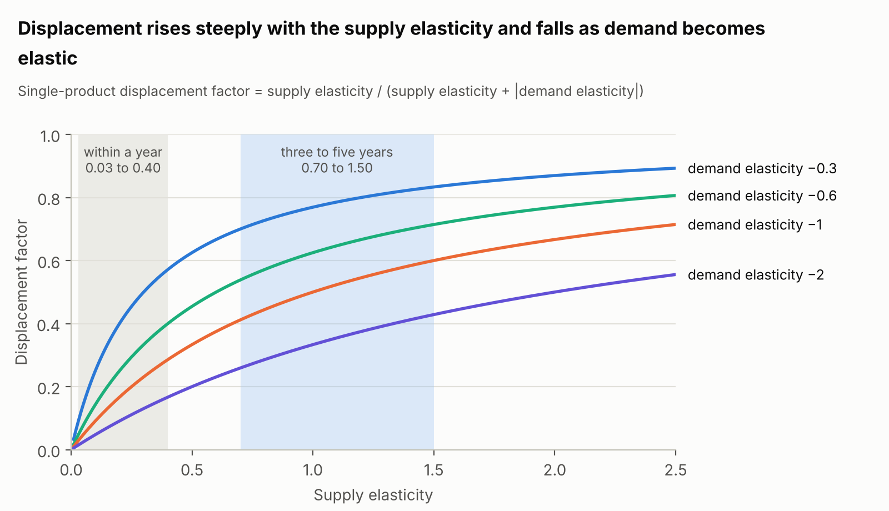

*Figure 1. Displacement factor against supply elasticity from the single-market formula; bands mark the supply elasticities used in this paper (sections 2 and 5)*

Joint products have their own literature. Houck (1964) showed that the elasticity of derived demand for a raw commodity that yields products in fixed proportions is the value-share-weighted harmonic mean of the product elasticities, which is dominated by the inelastic products; Wohlgenant (1989) and Piggott and Wohlgenant (2002) extended the treatment to complete systems and to trade, and Brester, Atwood and Boland (2023) give a textbook account of equilibrium displacement models with joint products. The animal-advocacy literature on displacement (Norwood and Lusk 2011; Harrington and Dubman 2008) works at the species level and reports that one pound given up removes 0.56 lb of milk, 0.68 lb of beef, 0.74 lb of pork and 0.76 lb of chicken, and one egg removes 0.91 eggs, with supply responses of 0.8 to 1.15 and demand elasticities of −0.2 to −0.6. The bundle rates in this paper (0.42 to 0.67 for the farmed animals after three to five years) are close to those figures for dairy and eggs and lower for broilers and hogs, because the cut-level demand elasticities used here (−0.75 to −1.5) are more elastic than the species-level −0.2 to −0.6 of that literature. All of these figures describe a reduction in demand for every product of the animal at once; the contribution of this paper is to carry the same method down to the products that are actually replaced.

## 3. Joint production: carcasses, milk and eggs as bundles

No farm animal produces a single product. A fed steer is a bundle of about 60 primal cuts and trimmings plus a hide, tallow, offal and meals; a laying hen produces shell, white and yolk in fixed proportions and ends as a carcass worth nothing; a hundred pounds of cheese milk produces about 10.6 lb of cheese and 90 lb of whey, which carries 6 lb of solids including 0.8 lb of protein. The buyer of any one of these products pays for a share of the animal, and the farmer's decision to keep or add an animal responds to the sum of those shares.

Two kinds of jointness need separating. Fixed proportions describe outputs that come out of the same animal in a ratio the processor cannot change: a carcass's primals, an egg's white and yolk, the whey that accompanies cheese, the heads and frames left after filleting a fish. Variable proportions, or fungible uses, describe a raw commodity that the processor can allocate between products: milk into fluid, cheese, butter and powder; eggs into the shell market or the breaking plant; pollock into fillet blocks or surimi. Under fixed proportions, a demand loss in one product lowers that product's price and raises the price of the others, because fewer animals means less of everything. Under fungible uses, the processor re-routes the commodity and the loss is spread across all products at a smaller price change each.

Houck (1964) showed that under fixed proportions the elasticity of derived demand for the raw commodity is the value-share-weighted harmonic mean of the product elasticities:

```latex
\varepsilon_{raw} = -\left(\sum_k \frac{s_k}{|\varepsilon_k|}\right)^{-1}
```

where s\_k is product k's share of the animal's value. The harmonic mean is dominated by the inelastic products: with cheese at 40% of a dairy cow's value and an elasticity of −0.55, and whey protein at 13% and −1.5, the whey contributes 0.08 to the sum and the cheese 0.73. Section 4 builds on this result; this section documents the bundles.

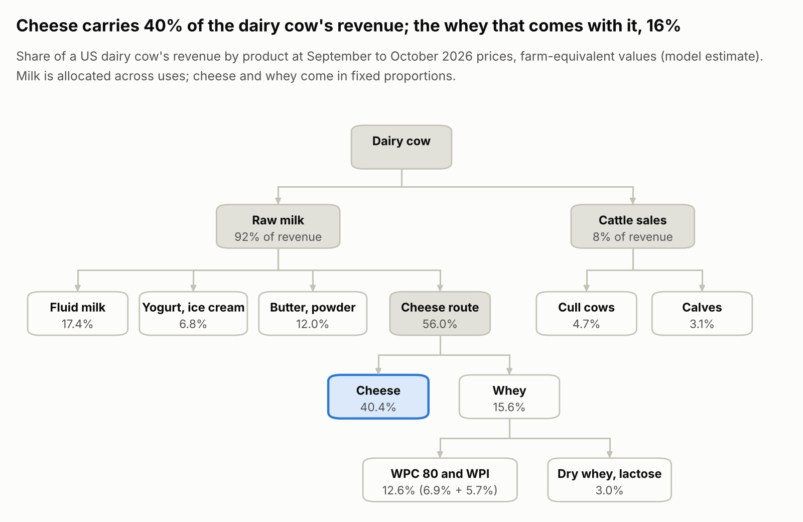

*Figure 2. Joint products of a US dairy cow: milk is allocated across uses, cheese and whey are joint, and the whey stream is allocated again across protein and carbohydrate products; value shares from the model at September to October 2026 prices (USDA AMS class prices and Dairy Market News; section 5)*

The dairy cow is the richest case because it has both kinds of jointness, nested. Raw milk is fungible across fluid use (about 19% of US milk), cheese (about 60%, derived from 14.8 billion lb of cheese in 2025 and a yield of 10.6 lb per hundredweight, that is per 100 lb of milk), butter and powder (13%) and other manufactured products (8%). Cheese milk then splits in fixed proportions into cheese and whey solids. The whey solids are separated into a protein fraction, sold as whey protein concentrate (WPC) or isolate (WPI) or left in dry whey, and a carbohydrate fraction, sold as dry whey, lactose or permeate or fed to animals; the model treats the two fractions as fixed-proportion streams and the outlets within each as fungible. In 2025 US plants made 845 million lb of dry whey, 502 million lb of WPC, 214 million lb of WPI and 1.14 billion lb of lactose ([USDA NASS Dairy Products 2025](https://esmis.nal.usda.gov/sites/default/release-files/795874/daryan26.pdf)); roughly half of the protein in liquid whey ends up in WPC or WPI, the rest in dry whey, condensed whey, feed or the drain. The cow also produces cattle: cull cows and calves were 7.8% of US dairy farm gross value in 2024 ([USDA ERS milk cost of production](https://www.ers.usda.gov/media/5059/by-size-of-operation.csv?v=60696)), and beef-on-dairy calves alone exceeded $5 per hundredweight of milk in 2026, a record.

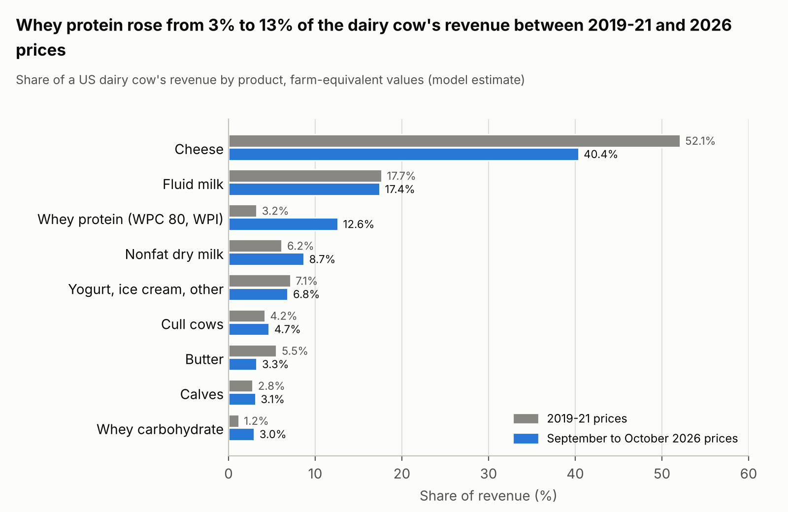

*Figure 3. Dairy revenue shares, model estimates from USDA AMS prices (2019–21 averages and September to October 2026) and the yields in section 5; workbook sheet Dairy, scenarios 1 and 2*

The carcass bundles are fixed-proportion bundles with a one-way escape valve: a whole-muscle cut can always be ground, but mince cannot be turned back into a steak. The weight and value shares diverge sharply. On the USDA boxed-beef cutout of 15 October 2026 (the value of a carcass computed from the prices of its primals, the large wholesale sections it is cut into), the rib and loin were 33% of carcass weight and 46% of carcass value; the chuck and round 52% and 44%; the brisket, plate and flank 15% and 10% ([USDA AMS boxed beef cutout](https://www.ams.usda.gov/mnreports/ams_2453.pdf); [yield factors](https://www.ams.usda.gov/sites/default/files/media/LMRBoxedBeefCutoutsUserGuide.pdf)). The by-products are 44% of a steer's live weight and about 6% of its value: the drop value, the packer's revenue from hide, offal, fat and meals per 100 lb of live weight, was $15.12 on the same day, of which the hide, once two thirds of beef by-product value, was $1.75 ([USDA AMS drop value](https://www.ams.usda.gov/mnreports/ams_2829.pdf); [Marti, Johnson & Mathews 2011](https://ers.usda.gov/sites/default/files/_laserfiche/outlooks/37427/8801_ldpm20901.pdf?v=54414)). A broiler is more skewed still: boneless breast and tenders are 26% of live weight and 55% of value at January 2025 prices, the whole legs 23% and 16%, and the backs, necks and frames that become mechanically separated chicken 12% and 2% ([Cobb 500 yields](https://cobbgenetics.com/assets/Cobb-Files/Broiler-Yield-Poster-English.pdf); [USDA AMS chicken parts](https://esmis.nal.usda.gov/sites/default/release-files/kp78hr440/sx61gg541/3f464086h/AMS_3646.PDF)). The hog is the most even bundle: in September 2026 the loin, butt and ribs were 40% of carcass weight and 43% of value, the ham 25% and 22%, the belly 16% and 17%, and the picnic and trim that go to sausage 15% and 10% ([USDA AMS pork cutout](https://www.ams.usda.gov/sites/default/files/media/LMRPorkCutoutHandout.pdf)).

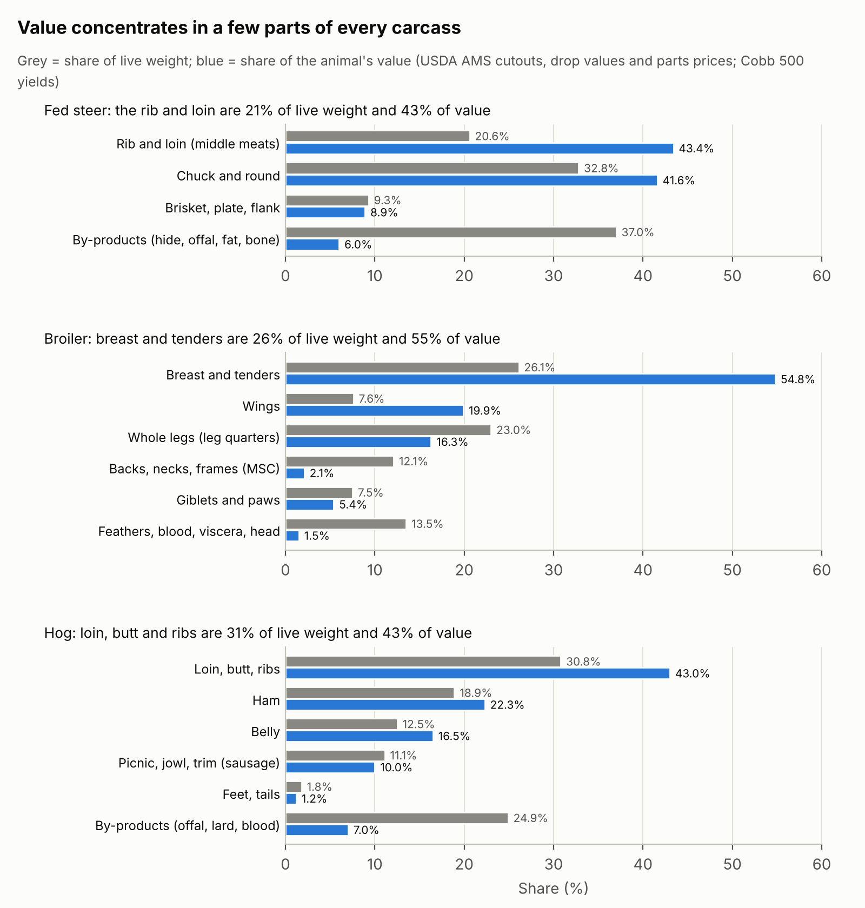

*Figure 4. Shares of live weight and of animal value by part; USDA AMS boxed beef cutout and drop value (15 Oct 2026), pork cutout (w/e 25 Sep 2026) and hog by-product value, chicken parts (24 Jan 2025), Cobb 500 yields; model aggregation*

The egg is a fixed-proportion bundle (shell 11%, white 58%, yolk 31% by weight; white is 11% protein, yolk 17.5% protein and 32.5% fat, [USDA egg grading manual](https://www.ams.usda.gov/sites/default/files/media/Egg%20Grading%20Manual.pdf)) inside a fungible allocation. About 68% of US table eggs are sold in shell and 32% are broken, about 2.4 billion dozen in 2025. Of the broken eggs roughly two thirds are sold as liquid or frozen whole egg and one third are separated, which yielded 681 million lb of white and 345 million lb of yolk in the first eleven months of 2025 ([USDA NASS egg products](https://esmis.nal.usda.gov/sites/default/release-files/795795/eggs0226.pdf)). Every egg broken for its white yields a yolk and vice versa, so the two prices are tied: the breaker's revenue from white plus yolk must at least match the whole-egg price plus the cost of separation (Faber 1971). A shell egg is worth about twice a breaking egg, $0.95 against $0.43 a dozen at 2019 prices, so the shell market is 68% of eggs by volume and 83% by value; the distinction matters for the model, which allocates eggs by volume and values them by price. The spent hen, after about 25 dozen eggs, weighs 3.3 lb and yields 166 g of meat; US plants quote a removal cost of 0 to 5 cents per bird ([USDA AMS fowl market](https://www.ams.usda.gov/mnreports/pywfowl.pdf); Freeman et al. 2009). The layer's meat is a by-product with no price.

Fish are bundles of flesh and frames. A skinless pollock fillet is about 36% of round weight, cod 36% to 42%, tilapia 37%, salmon fillet about 65% of head-on-gutted weight ([FAO yield tables](https://www.fao.org/4/T0219E/T0219E03.htm)). In the 2024 season (NOAA data through late October) the Alaska pollock catch produced about 170 kt of surimi, 168 kt of fillets, 40 kt of headed-and-gutted fish, 21 kt of roe, 70 kt of fishmeal and 27 kt of fish oil ([NOAA via SeafoodSource](https://www.seafoodsource.com/news/supply-trade/alaska-wraps-up-pollock-fishing-in-2024-strong-bering-sea-b-season-brings-catch-totals-near-limit)); fillets, surimi and roe were 86% of first-wholesale value in 2019 ([NOAA economic SAFE](https://apps-afsc.fisheries.noaa.gov/refm/docs/2020/econGroundfishSafe.pdf)). Norway's seafood sector generated 1.14 million tonnes of rest raw material in 2023 and used 88% of it, mostly as ensilage (acid-preserved fish silage for feed) and fishmeal; the salmon by-products were worth about NOK 7 per kg against NOK 60 to 75 per kg for the fish ([SINTEF 2024](https://sintef.no/contentassets/f87ee6b4a78846888459395cc020262e/analyse-marint-restrastoff-2023-1.pdf)).

The vocabulary of co-products, by-products and side-streams is best defined by economics. A co-product is an output whose value is large enough that the producer would change the production decision if it disappeared: cheese and fluid milk, breast meat, bellies and hams. A by-product is an output whose quantity is set by the primary product and whose price adjusts to clear whatever comes out: whey before 2007, hides, trim, backs and necks, spent hens, fish frames. A side-stream or waste is a by-product whose next-best use has a price at or below zero, so that disposal is a cost: whey for the Californian cheese plants that paid up to $1 per hundredweight of milk to get rid of it in 2015, spent hens, feathers. The same material can move between these classes as demand changes, and whey has moved through all three within twenty years.

### By-product prices and floors

A by-product's quantity is decided elsewhere. Cheese makers do not choose how much whey to make, and breakers do not choose how much yolk comes with the white. Supply of the by-product is therefore vertical at whatever the primary product throws off, and its price is set entirely on the demand side: it is the price at which buyers absorb that quantity. This is residual pricing, and it has two consequences. The by-product's price can fall a long way without any change in production, and it cannot fall below the value of the material in its next-best use, because at that price the alternative outlet takes everything.

That next-best use is the floor. For most animal by-products the outlet is feed, rendering, pet food or an export market that takes the material at a world price. Feed-grade dry whey sold at $0.35 to $0.38 per lb in October 2026 against $0.64 to $0.80 for edible dry whey ([USDA Dairy Market News](https://www.ams.usda.gov/mnreports/dywweeklyreport.pdf)). Breaking stock eggs sold at $0.08 per dozen against $0.43 for shell eggs in the same month, and at $1.39 against $2.08 in the tight market of September 2025 ([USDA egg markets overview](https://www.ams.usda.gov/mnreports/ams_3725.pdf)). Fifty-percent lean beef trim sold at $0.93 per lb against $3.99 for 90% lean ([USDA carlot report](https://www.ams.usda.gov/mnreports/lswwklyblue.pdf)); mechanically separated chicken at $0.24 per lb in October 2026 against $1.49 for boneless breast in January 2025; a steer hide at $24.50 per hide, about the cost of collecting it; a spent hen at a removal cost of 0 to 5 cents. For whey the floor was below zero for decades: the cheese industry disposed of an estimated 47% of its whey in drains worldwide (Zandona et al. 2021), and small Californian plants paid up to $1 per hundredweight of milk for disposal as late as 2015 ([Murphy, FMMO hearing testimony](https://www.ams.usda.gov/sites/default/files/media/Exhibit%20117%20-%20Testimony%20of%20Barry%20Murphy%20Part%201.pdf)).

The distance between a by-product's current price and its floor is the part of its price that is rent on a fixed supply, and it is the part a substitute removes first. The table gives the floor ratios used in the model, each a judgement anchored on a quoted outlet price.

| Stream | Current price (as of) | Next-best use | Floor ratio used |
| --- | --- | --- | --- |
| Whey protein (WPC 80, WPI) | $9.5 and $14 per lb (Oct 2026) | protein valued as feed or dry whey, $0.35–0.70 per lb of solids | 0.06 |
| Whey carbohydrate (dry whey, lactose, permeate) | $0.67–0.70 per lb | feed-grade whey, permeate, $0.35 per lb | 0.50 |
| Nonfat dry milk / SMP | $1.53 per lb nonfat solids | feed-grade SMP, export at world price | 0.60 |
| Cull cows | $1.19–1.37 per lb (cutter, 2024–25) | rendering, pet food | 0.15 |
| Dairy bull calves | $1,550–1,850 per head (2026) | bob veal, on-farm euthanasia | 0.05 |
| Beef grinding material | \~$3.00 per lb blended | pet food, rendering | 0.30 |
| Beef drop credit (hide, tallow, offal, meals) | $15.12 per cwt live | rendering, disposal | 0.40 |
| Whole liquid egg | $0.33 per lb (2019); $1.16 (2025) | dried whole egg inventory, export, feed | 0.50 |
| Separated egg white | $0.23 per lb (2019); $0.91 (2025) | dried albumen at surplus prices, feed | 0.35 |
| Separated egg yolk | $0.46 per lb (2019); $3.57 (2025) | industrial yolk, pet food | 0.50 |
| Chicken dark meat (leg quarters) | $0.51 per lb | export at world price, pet food | 0.25 |
| Backs and necks (MSC) | $0.125 per lb | rendering | 0.50 |
| Chicken giblets and paws | $0.40 and $0.60 per lb | export at world price, rendering | 0.15 |
| Pork sausage material (picnic, trim) | $0.66 per lb | pet food, rendering | 0.30 |
| Hog drop credit and variety meats (lard, offal, meals, plasma; feet, tails) | $14.34 per head; feet and tails $0.50 per lb | rendering, export | 0.40 |
| Pollock roe | \~$6,000 per t | fishmeal | 0.30 |
| Salmon by-products (heads, frames, trimmings) | NOK 7 per kg | ensilage, fishmeal | 0.30 |
| Fishmeal, fish oil, rendering streams | at floor | none below | 1.00 |

A floor does three things in the model. First, it bounds the price fall: a demand shift large enough to reach it stops lowering the product's price, so further replacement is absorbed by the outlet and the animal is untouched. Second, it bounds the displacement: the maximum reduction in animals obtainable through a by-product alone is the effect of taking its price to the floor. Third, it defines sustained price parity for a substitute: a novel ingredient that aims to remove the by-product from the market has to be priced at the floor, because that is where the by-product will be priced once it has lost its food demand.

Floors move, and so does the rent above them. Dry whey sold for 14 to 34 cents per lb from 1999 to mid-2006, contributed 2% to 5% of the value of cheese milk, and was described by the dairy press as "gutter to gold" when it reached 78 cents in 2007 ([USDA ERS Amber Waves 2008](https://ageconsearch.umn.edu/record/123222/files/Whey.pdf); [Sommer 2007](https://www.cheesemarketnews.com/guestcolumn/2007/19oct07_02.html)). It fell back to 25 cents in July 2023, the feed-grade floor of the time, and stood at 68 cents in September 2026 ([USDA Dairy Market News monthly series](https://www.ams.usda.gov/mnreports/dymawhey_cent.pdf)). The protein fraction moved further: WPC 80 traded under $4 per lb in 2023 and at $9 to $13 in 2026, WPI at $13 to $15 ([USDA Dairy Market News WPC report](https://www.ams.usda.gov/mnreports/ams_1053.pdf)), and the trade press now describes whey as "the tail wagging the dog" of cheese-plant economics ([Dairy Herd, October 2026](https://www.dairyherd.com/news/tail-wagging-dog-how-dairys-byproducts-became-main-event)). Egg white followed the same path a decade earlier: dried whites rose from $4.65 to $8.95 per lb in 2013 and overtook dried yolk, reversing a premium that had run the other way for fifty years ([Baking Business 2013](https://www.bakingbusiness.com/articles/23872-egg-white-craze-pushes-prices-to-record-highs)); in July 2025, after avian influenza, dried albumen reached $24 per lb.

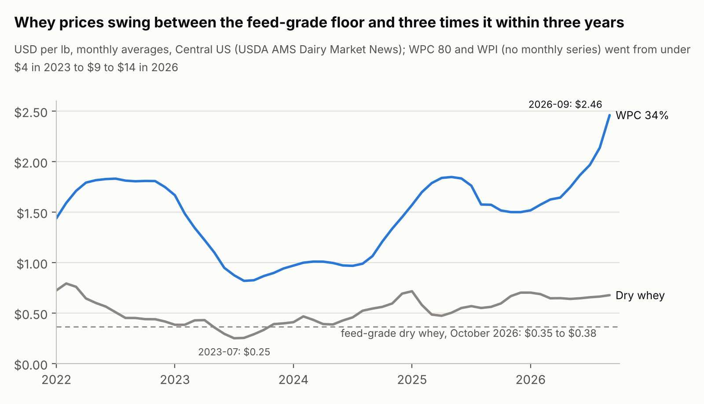

*Figure 5. USDA AMS Dairy Market News monthly average mostly prices, Central US dry whey and WPC 34%, January 2022 to September 2026; feed-grade dry whey quote of 5 to 9 October 2026*

Two lessons follow for substitutes. A by-product's price today is a snapshot of a rent that the fixed supply happens to earn, and the same fixed supply means the rent falls as the substitute takes share and reaches the floor only on near-total replacement, because the dairy whey or the egg white does not leave the market. The animal is unaffected: through the whole whey cycle from gutter to gold, cheese output was decided by cheese demand and milk prices, with whey adding or subtracting a few percent of the cheese maker's revenue.

## 4. The model

The model is a log-differential equilibrium displacement model in the tradition of Muth (1964), Gardner (1975), Wohlgenant (1989) and Alston, Norton and Pardey (1995), with Houck's (1964) treatment of fixed-proportion joint products nested inside a fungible allocation of the raw commodity. Every variable is a proportional change from the initial equilibrium, written E(x) = dx/x. The closed form is exact for small shifts; for large shifts and for threshold questions the paper uses an exact non-linear solution of the same system, described in section 4.3.

### 4.1 Structure and closed form

Each unit of an animal yields two kinds of output. Fixed streams come with the animal in fixed proportions and are sold as they come: the parts of a carcass, the cull cow and calf that come with a dairy cow's milk, the spent hen that comes with a laying hen's eggs. Each fixed stream k has a share s\_k of the animal's value and an own-price demand elasticity ε\_k. A raw commodity, milk or eggs, with value share W\_raw, is allocated by processors across fungible routes r (fluid, cheese, butter and powder, other manufactured products; the shell market and the breaking plant), each taking a share a\_r of the raw volume. Within a route, streams are joint products in fixed proportions (cheese and whey solids; white and yolk) with value shares S\_k inside the route and elasticities ε\_k; within a stream, sub-products are fungible outlets with shares w\_i (WPC 80 and WPI within whey protein; fillets and surimi within pollock flesh). The animal is supplied with elasticity ε\_s.

Processors allocate the raw commodity so that its value per unit moves in proportion across routes, which keeps today's relative values (the classified-pricing structure of US milk, the shell premium over breaking eggs) in place. Under that assumption the route's derived demand is Houck's harmonic mean, the raw commodity's demand elasticity is the volume-weighted mean of the route elasticities, and the animal's demand inelasticity H adds the fixed streams:

```latex
\varepsilon_r = -\Big(\sum_{k \in r} \frac{S_k}{|\varepsilon_k|}\Big)^{-1}, \qquad \varepsilon_{raw} = \sum_r a_r\, \varepsilon_r, \qquad H = \sum_{k\ \mathrm{fixed}} \frac{s_k}{|\varepsilon_k|} + \frac{W_{raw}}{|\varepsilon_{raw}|}, \qquad \bar{\varepsilon} = -\frac{1}{H}
```

A proportional demand shift κ\_k on stream k (for example −0.10 for a 10% replacement at constant prices) is, in quantity terms at the route level, κ\_r = |ε\_r| S\_k κ\_k / |ε\_k|. Animal numbers respond to the sum of the shifts weighted by each product's place in the structure:

```latex
E(A) = \frac{\varepsilon_s}{1 + \varepsilon_s H}\Big[\sum_{k\ \mathrm{fixed}} \frac{s_k}{|\varepsilon_k|}\,\kappa_k + \frac{W_{raw}}{|\varepsilon_{raw}|}\sum_r a_r\, \kappa_r\Big]
```

The displacement factor of a stream is the change in animals per unit of proportional shift in that stream. For a fixed stream, for a stream inside a fungible route, and for a sub-product within a stream:

```latex
DF_k = \frac{\varepsilon_s}{1 + \varepsilon_s H}\cdot\frac{s_k}{|\varepsilon_k|}, \qquad DF_k = \frac{\varepsilon_s}{1 + \varepsilon_s H}\cdot\frac{W_{raw}}{|\varepsilon_{raw}|}\, a_r\, |\varepsilon_r|\,\frac{S_k}{|\varepsilon_k|}, \qquad DF_i = w_i\, DF_k
```

Three special cases check the formula. With every stream fixed it reduces to Houck's case. With every stream its own route and no fixed streams it reduces to the fungible case, DF\_k = ε\_s a\_k / (ε\_s + |ε\_raw|), in which the product's own elasticity drops out because the commodity is re-routed. With a single product it reduces to ε\_s/(ε\_s + |ε\_d|), the cumulative elasticity of section 2. Summing over all streams gives the bundle factor ε\_s H/(1 + ε\_s H) = ε\_s/(ε\_s + |ε̄|), the effect of giving up every product in proportion.

Routes are weighted by their share of raw volume, a\_r, and valued by their share of value, W\_r. The two coincide when every use pays the same per unit of raw commodity, which is the case for a carcass and nearly so for milk, and they differ for eggs, where a shell egg is worth about twice a breaking egg. A version of the model that weighted routes by value would overstate the shell-egg factor by a third and understate the egg-product factors by half.

Prices follow from the same system. For a shift on stream k alone, E(P\_A) = E(A)/ε\_s is the farm price, E(P\_raw) = (E(A) − a\_r κ\_r)/ε\_raw the raw commodity price, the route quantity changes by E(Q\_r) = ε\_r E(P\_raw) + κ\_r and the stream's own price by E(P\_k) = (E(Q\_r) − κ\_k)/ε\_k. The prices of the other streams in the same route change by E(Q\_r)/ε\_j, which is a rise, because less of the bundle is produced; the prices of products in other routes move with the raw commodity; a fixed stream's price moves by (E(A) − κ\_k)/ε\_k. The ratio g\_k = E(P\_k)/κ\_k is the stream's price response per unit of shift.

Processing margins are assumed proportional, so value shares at wholesale equal value shares at the farm; where margins are absolute, as the dairy make allowances are, farm-level demand is less elastic than retail demand (Gardner 1975) and every factor is somewhat higher than reported here.

### 4.2 Three horizons and two discounts

The factor depends on ε\_s, and ε\_s depends on how long producers have to respond. The paper reports every factor at three horizons: within a year, using the short-run supply elasticities of section 2; three to five years, using the long-run values; and the constant-cost limit, in which ε\_s goes to infinity and the factor becomes the product's weight in the animal's demand, the bracketed term divided by H. The limit is the number a reader who believes in a horizontal long-run supply curve should use, and it is the upper bound of the model for any supply response.

The three horizons separate two discounts that every factor contains. The elasticity discount, 1/(1 + ε\_s H), is the share of a demand reduction that is absorbed by lower prices and other buyers; it falls as ε\_s rises and is zero in the limit. The joint-production discount is the product's weight in the animal's demand relative to the bundle's; it depends on value shares and demand elasticities only and does not move with the horizon. For cheese on the 2026 price structure the weight is 0.49 and the factor is 0.08, 0.28 and 0.49 at the three horizons; for the whey protein stream the weight is 0.056 and the factor is 0.009, 0.032 and 0.056. The ratio between the two, a factor of about nine, is the joint-production discount, and it is the same at every horizon.

### 4.3 Three regimes: the margin, the product line, the animal

The factor is a marginal quantity. It describes what the next tonne replaced does, with prices moving along today's demand and supply curves, and it is the right number for impact accounting of the form "tonnes replaced times factor". It cannot describe a substitute that takes a product's whole market, because the constant-elasticity demand curves of the closed form never reach zero. For that the paper solves the same system exactly, in levels, with two additions: floors, and perfect substitutes at a fixed price.

A floor is attached to streams with an external outlet. Below the floor price the outlet (feed, rendering, export at world price) takes the material, so the stream's price stops falling and further replacement is absorbed by the outlet with no effect on the animal. In the closed form, with constant-elasticity demand, a stream reaches its floor ratio φ\_k (floor price over current price) at the shift κ\_floor = φ\_k^(1/g\_k) − 1. In the exact solution the floor is a constraint on the price.

A perfect substitute offered at a price π times today's price caps the animal product's price at π. The animal keeps producing its joint output and sells all of it at the cap; the substitute supplies whatever buyers want beyond that at the lower price; the co-products' prices rise as the animal contracts; the raw commodity moves between routes until values are again proportional; and the herd or flock shrinks along its supply curve, or, in the constant-cost limit, until the remaining products again cover the cost of the animal. The solution is a single equilibrium in animal numbers, route allocations and prices, found by nested bisection. Three cases of it define the regimes.

The marginal regime is the closed form, which the exact solution reproduces to within 1.5% of the effect for a 10% shift in a primary product of a land animal.

The product-exit regime is a cap on one product. The animal's response rises as the cap falls, and for a product that is the sole output of a fungible route there is a threshold: once the capped price falls below the value of the raw commodity in its other uses, no raw commodity goes to that product at all, the substitute has the whole market, and the animal is sized by the remaining uses. For fluid milk the threshold is 87% of the Class I value and for shell eggs 56% of the shell price, after three to five years; in the constant-cost limit it is a discount of about 3% for fluid milk and any discount for shell eggs, because the farm price returns to cost and a product priced below it cannot compete for the raw commodity. For a product that shares its route with joint products there is no threshold: cheese capped at a tenth of today's price still receives milk, because the whey that comes with it rises in price and carries the route. For carcass parts there is no threshold either, because the part comes with the animal whatever it fetches.

The animal-exit regime is a cap on every product of the animal at once, the whale-oil case. Then the farm price is π, nothing on the demand side matters, and animal numbers after three to five years are π raised to the power ε\_s: at 75% of today's prices, 82% of broilers, 77% of milk output and 65% of hogs remain, and at any sustained discount none remain in the constant-cost limit. Between the second and third regime lies the exit condition in words: an animal leaves the system when the sum of its products' revenue at post-substitution prices falls below the cost of keeping it, and a product with value share s lowers revenue by at most s when its market is lost, less once the co-products' prices rise. No by-product can trigger exit on its own; a primary product can only where the rest of the bundle cannot carry the animal. Salmon fillets (97% of the fish) qualify, and shell eggs (83% of the hen) come close, since losing them removes 68% of the flock in the limit while the breaking route carries the rest; cheese (40% of the cow) does not on its own, because the milk re-routes to fluid, butter and powder and those markets have to saturate first.

### 4.4 Validation and implementation

The closed form was checked against the exact solution for every stream of every branch at shifts of 10% and 25%. For the primary products of the land animals the closed form is within 1.5% of the exact animal effect at a 10% shift and within 3.5% at 25%; for salmon and pollock flesh, where one stream is nearly the whole animal, it is within 3% to 4% and 7% to 10%; for the smallest and most elastic by-product streams (rendering, spent hens, fishmeal) it understates the exact effect by about 4% at a 10% shift and by about 10% at 25%, on factors below 0.003, and for the cattle sales of the dairy cow it overstates it by 3% and 9%. Every full-replacement and price-cap figure in this paper comes from the exact solution; the closed form is used for the factors and for the price responses to small shifts.

Cross-price effects between different animals (beef against chicken, for example) are not modelled; they would raise the displacement of one species at the expense of another and leave total animal production effects smaller than the single-species figures.

The workbook implements the closed form with live formulas. Each branch sheet holds the inputs (yields, prices, allowances, in blue), the product table with value shares, the stream table with demand elasticities and floor ratios (editable), the route table with raw-volume shares, the aggregates, and for each product the factor at three horizons, the two bounding variants (all fixed and all fungible), the price response, the floor shift, the full-replacement effect and the animal mass displaced per unit of product. A Summary sheet links all branches, a Sensitivity sheet gives the single-product factor across the elasticity grid and a target calculator, a Ranges sheet holds the Monte Carlo percentiles, an Exit sheet holds the price-cap and full-loss solutions from the exact model, and a Sources sheet lists every page used.

## 5. Data and calibration

Every parameter is tagged in the workbook as sourced \[S\], estimated from sourced inputs \[E\] or assumed \[A\]. Yields, prices and volumes are \[S\] with a few \[E\] splits; aggregate demand elasticities for primary products are \[S\]; demand elasticities for by-product streams are \[A\], chosen to reflect the substitutes each stream faces, and they are the main sensitivity. Supply elasticities and floors are documented in sections 2 and 3. The table gives the value shares and stream elasticities that drive the results, at the price snapshot named for each animal.

| Animal (price snapshot) | Stream | Share of animal value | Demand elasticity | Basis |
| --- | --- | --- | --- | --- |
| Dairy cow (Sep–Oct 2026) | Cheese | 40.4% | −0.55 | \[S\] Andreyeva 0.44, Okrent & Alston 0.70, EU 0.60 |
|  | Fluid milk | 17.4% | −0.40 | \[S\] Andreyeva 0.59, Okrent & Alston 0.10, EU 0.53 |
|  | Whey protein (WPC 80, WPI) | 12.6% | −1.50 | \[A\] ingredient with substitutes; soybean meal flexibility 1.12 (Houck 1964) |
|  | Nonfat dry milk | 8.7% | −1.00 | \[A\] traded commodity |
|  | Other manufactured (Class II) | 6.8% | −0.90 | \[S\] Okrent & Alston other dairy 1.04 |
|  | Cull cows (fixed to the cow) | 4.7% | −0.80 | \[S\] beef demand |
|  | Butter | 3.3% | −0.60 | \[S\] EU butter 0.47, fats 0.48 |
|  | Calves (fixed to the cow) | 3.1% | −0.60 | \[A\] derived from fed beef |
|  | Whey carbohydrate (dry whey, lactose, permeate) | 3.0% | −2.00 | \[A\] feed outlet |
| Dairy cow (2019–21 prices) | Cheese 52.1%; fluid 17.7%; whey protein 3.3%; whey carbohydrate 1.2%; powder 6.2%; butter 5.5%; other 7.1%; cattle 7.0% |  | same |  |
| Fed steer (15 Oct 2026) | Middle meats (rib, loin) | 43.4% | −1.00 | \[S\] beef 0.75; cuts more elastic |
|  | Minced beef (trim, ground chuck/round) | 24.6% | −0.85 | \[S\] beef 0.75; ground beef 1.25 |
|  | End-meat and thin-meat whole-muscle | 26.0% | −0.90 | \[A\] as beef |
|  | Drop credit | 6.0% | −2.50 | \[A\] traded by-products |
| Laying hen (2019–21 prices) | Shell eggs (68% of eggs) | 82.8% | −0.27 | \[S\] Andreyeva 0.27, Okrent & Alston 0.24 |
|  | Whole liquid egg (20% of eggs) | 11.2% | −0.80 | \[A\] breaker demand more elastic (Blakely 1984) |
|  | Separated white; separated yolk (12% of eggs) | 2.9%; 3.1% | −1.50; −1.00 | \[A\] |
|  | Spent hen (fixed to the hen) | 0.1% | −5.00 | \[A\] no price |
| Laying hen (Sep 2025 prices) | Shell 70.9%; whole 15.3%; white 4.4%; yolk 9.3% |  | same |  |
| Broiler (24 Jan 2025) | Breast and tenders | 54.8% | −0.80 | \[S\] poultry 0.68–0.81 |
|  | Dark meat (whole legs) | 16.3% | −1.50 | \[A\] export-exposed |
|  | Wings | 19.9% | −1.00 | \[A\] |
|  | Giblets and paws | 5.4% | −2.00 | \[A\] export |
|  | Backs and necks (MSC) | 2.1% | −3.00 | \[A\] residual material |
|  | Rendering | 1.5% | −5.00 | \[A\] |
| Hog (25 Sep 2026) | Fresh cuts (loin, butt, ribs) | 43.0% | −0.90 | \[S\] pork 0.72; loin 1.45 |
|  | Ham | 22.3% | −0.75 | \[A\] processed |
|  | Belly | 16.5% | −0.80 | \[S\] bacon 0.83 |
|  | Sausage and trim | 10.0% | −1.20 | \[A\] competes with other trim |
|  | Variety meats and drop | 8.2% | −2.50 | \[A\] |
| Alaska pollock (2024 mix) | Flesh (fillets, H&G, surimi, mince) | 81% | −1.10 | \[S\] whitefish −0.5 to −1.9 |
|  | Roe | 7.8% | −1.00 | \[A\] |
|  | Meal and oil | 11.6% | −5.00 | \[A\] already at the outlet price, so near-perfectly elastic for one supplier; aggregate fishmeal demand is inelastic (Tveteras 2010) |
| Farmed salmon (2026) | Flesh | 97.0% | −1.00 | \[S\] salmon about −1 |
|  | By-products | 3.0% | −3.00 | \[A\] |

The dairy shares deserve a note on method. They are farm-equivalent values: each product's wholesale price less its make allowance (the processing cost that the federal milk order formulas deduct from the product price), times its yield per hundredweight of milk, with milk allocated across uses by the national utilisation estimate. For cheese and dry whey the make allowances are the Federal Milk Marketing Order values in force since June 2025 ($0.2519 and $0.2668 per lb, [USDA AMS final rule](https://www.federalregister.gov/documents/2025/01/17/2025-00563/milk-in-the-northeast-and-other-marketing-areas-uniform-pricing-formula-provisions)); for WPC 80 and WPI they are assumptions of $1.50 and $2.50 per lb, because the orders value whey only at dry-whey prices. The whey protein share is sensitive to those two assumptions and to the share of whey protein recovered into WPC and WPI, set at 50% from the 2025 production volumes; a reader who thinks recovery is 65% will find the share at 2026 prices closer to 16%.

The egg shares use the 2019 price relationships for the base case because the 2025 and 2026 markets are the two ends of an avian-influenza cycle: shell eggs at $2.08 per dozen in September 2025 and $0.43 in October 2026. The meat shares use the latest USDA cutouts available in October 2026; for broilers the January 2025 report is used because the October 2026 parts prices were compressed to the point where breast meat traded at the whole-bird price, which is not a representative structure.

The 80% ranges reported with every factor come from 2,000 draws per animal. Each stream's demand elasticity is drawn lognormally around its point value with a standard deviation of 0.25 in logs for sourced streams and 0.45 for assumed streams (an 80% interval of roughly ×/÷1.4 and ×/÷1.8). Long-run supply elasticities are drawn lognormally with standard deviations chosen to span the literature range: 0.6 for dairy, 0.35 for cattle, 0.4 for laying hens, 0.7 for broilers, 0.3 for hogs, 0.8 for salmon, and a uniform draw between 0 and 0.17 for pollock; short-run supply elasticities use 0.5. Prices and value shares are held at the scenario snapshot, and the two dairy and two egg scenarios show that sensitivity separately.

## 6. Results

### 6.1 The ranking of products

The table collects the factors for the products most often discussed as targets for replacement, at the three horizons, with the 80% range over the elasticity literature at the three-to-five-year horizon and the effect of losing the product's market entirely from the exact solution. The point estimates fall into three tiers: primary products and main cuts between 0.10 and 0.46, secondary cuts and secondary dairy and egg products between 0.03 and 0.09, by-products and quota-limited products below 0.03. The tiers survive the sampling of section 6.9: in every one of the 2,000 draws per animal the primary product carries a higher factor than any by-product of the same animal.

| Product | Share of animal value | DF within a year | DF 3–5 years (80% range) | DF constant-cost limit | Animal change if the product's market is lost (3–5 years) |
| --- | --- | --- | --- | --- | --- |
| Shell eggs | 82.8% | 0.040 | 0.458 (0.358–0.530) | 0.680 | −44% |
| Farmed salmon fillets | 97.0% | 0.088 | 0.435 (0.200–0.698) | 0.990 | −89% |
| Cheese | 40.4% | 0.075 | 0.282 (0.178–0.366) | 0.490 | −28% |
| Chicken breast | 45.2% | 0.051 | 0.230 (0.116–0.369) | 0.549 | −25% (share of the stream) |
| Beef middle meats | 43.4% | 0.056 | 0.190 (0.129–0.265) | 0.419 | −22% |
| Ham | 22.3% | 0.083 | 0.169 (0.095–0.269) | 0.271 | −14% |
| Pork loin | 23.1% | 0.071 | 0.146 (0.103–0.188) | 0.234 | −15% (share of the stream) |
| Whole liquid egg | 11.2% | 0.012 | 0.138 (0.108–0.160) | 0.205 | −15% |
| Beef grinding material | 24.6% | 0.038 | 0.127 (0.082–0.176) | 0.279 | −8.4% |
| Pork belly | 16.5% | 0.057 | 0.117 (0.078–0.158) | 0.188 | −9.8% |
| Fluid milk | 17.4% | 0.027 | 0.101 (0.066–0.131) | 0.176 | −10% |
| Chicken wings | 19.9% | 0.018 | 0.081 (0.035–0.152) | 0.194 | −8.6% |
| Separated egg yolk | 3.1% | 0.004 | 0.048 (0.029–0.063) | 0.071 | −3.7% |
| Pork sausage material | 10.0% | 0.023 | 0.047 (0.025–0.083) | 0.076 | −4.0% |
| Chicken dark meat | 16.3% | 0.010 | 0.044 (0.019–0.086) | 0.106 | −5.1% |
| Nonfat dry milk (casein route) | 8.7% | 0.011 | 0.043 (0.024–0.059) | 0.074 | −2.4% |
| Separated egg white | 2.9% | 0.003 | 0.030 (0.016–0.045) | 0.044 | −3.0% |
| WPC 80 (2026 prices) | 6.9% | 0.005 | 0.018 (0.009–0.032) | 0.031 | −2.4% (share of the stream) |
| WPI (2026 prices) | 5.7% | 0.004 | 0.015 (0.007–0.026) | 0.025 | −2.0% (share of the stream) |
| WPI (2019 prices) | 1.6% | 0.001 | 0.004 (0.002–0.007) | 0.006 | −0.5% (share of the stream) |
| Pollock fillets (quota) | 47.0% | 0.000 | 0.020 (0.007–0.063) | n/a | −4.5% (share of the stream) |
| Mechanically separated chicken | 2.1% | 0.001 | 0.003 (0.001–0.006) | 0.007 | −0.4% |
| Beef hide | 0.7% | 0.000 | 0.001 (0.001–0.002) | 0.003 | −0.2% (share of the stream) |
| Fishmeal (pollock) | 7.3% | 0.000 | 0.001 (0.000–0.003) | n/a | −0.4% (share of the stream) |

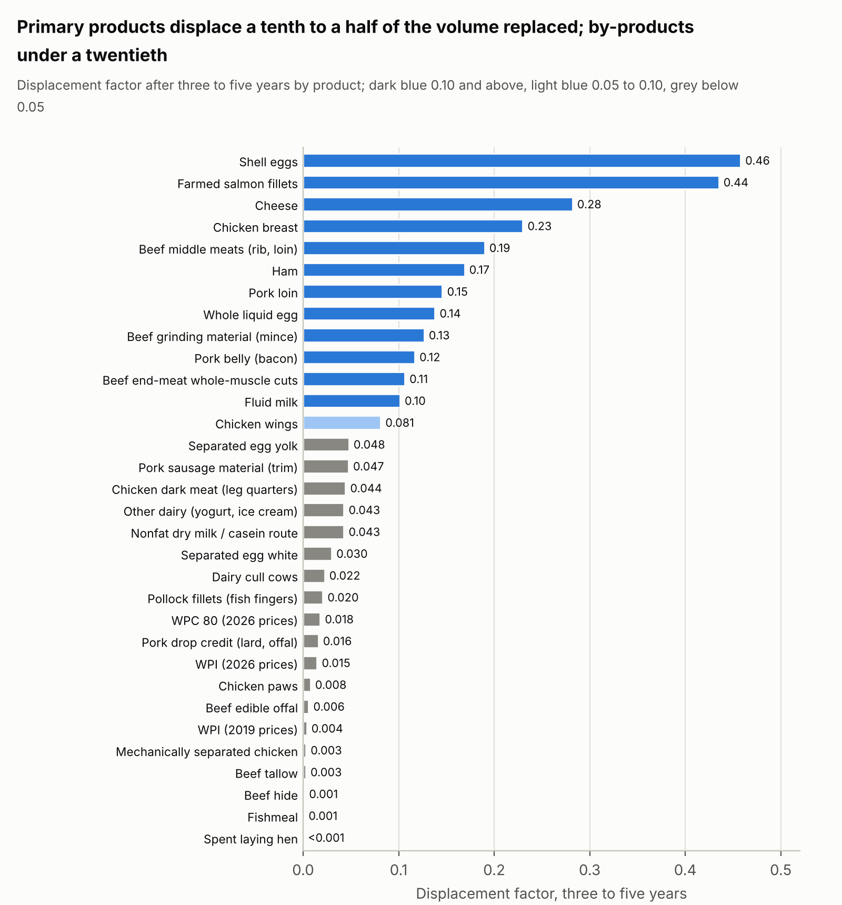

*Figure 6. Displacement factors after three to five years from the model (section 6; workbook Summary sheet); dairy at 2026 prices unless stated, eggs at 2019–21 prices*

The two discounts of section 4.2 can be read off the three columns. Moving from the first to the third column removes the elasticity discount: cheese goes from 0.08 to 0.49, chicken breast from 0.05 to 0.55, whey protein isolate from 0.004 to 0.025. The joint-production discount is the distance between rows, and it is the same in every column: the whey protein stream carries a ninth of the cheese factor within a year, after five years and in the limit. The figure draws the two.

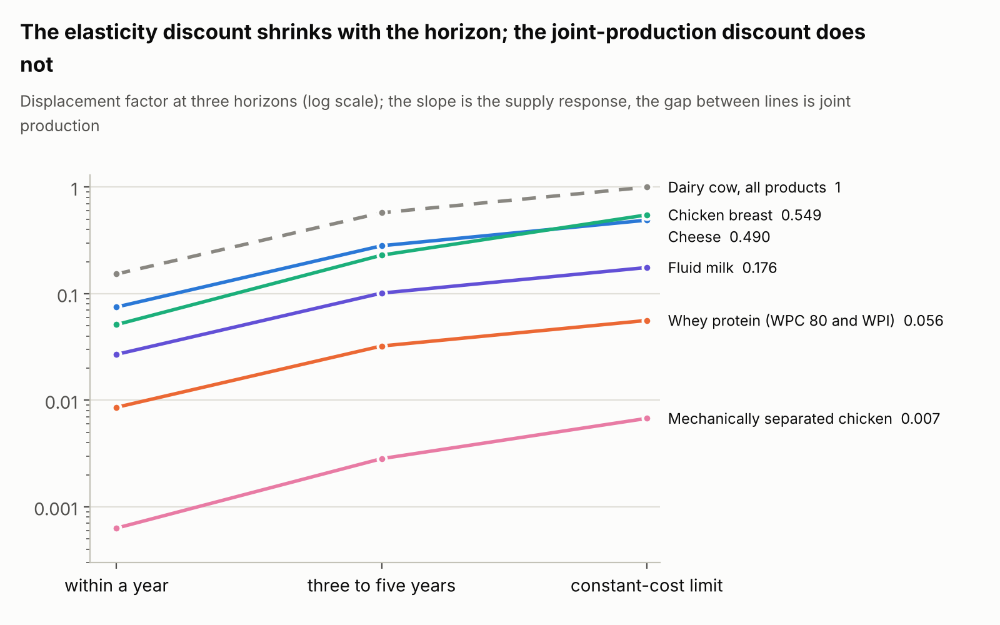

*Figure 7. Displacement factors at three horizons for six products, log scale; the slope of each line is the elasticity discount closing with the horizon, the vertical gap between lines is the joint-production discount, which the horizon does not close*

### 6.2 The dairy cow

Cheese decides the dairy cow; the whey protein that comes with it has almost no effect on it. On the 2026 price structure the three-to-five-year factor is 0.28 for cheese, 0.10 for fluid milk, 0.04 for nonfat dry milk and other manufactured products, 0.018 for WPC 80 and 0.015 for WPI; within a year every factor is about a quarter of its five-year value because the milk supply elasticity is 0.12 within the year, and in the constant-cost limit every factor is about 1.7 times its five-year value. A 10% replacement of cheese lowers the farm milk price by 3.1% and milk output by 2.8%, lowers the cheese price by 6.7%, and raises the price of the whey protein stream by 4.2% because less cheese means less whey. A 10% replacement of WPI lowers whey protein prices by 2.8% and milk output by 0.15%.

| Dairy product | Share of animal value | DF within a year | DF 3–5 years (80% range) | DF 3–5 years, 2019 prices | DF constant-cost limit | Stream price change for a 10% replacement | Change in milk if the product's market is lost: 3–5 years; constant-cost limit |
| --- | --- | --- | --- | --- | --- | --- | --- |
| Cheese | 40.4% | 0.075 | 0.282 (0.178–0.366) | 0.329 | 0.490 | −6.7% | −28%; −47% |
| Fluid milk | 17.4% | 0.027 | 0.101 (0.066–0.131) | 0.107 | 0.176 | −1.3% | −10%; −17% |
| Nonfat dry milk / SMP (casein route) | 8.7% | 0.011 | 0.043 (0.024–0.059) | 0.029 | 0.074 | −4.3% | −2.4%; −4.2% |
| Other manufactured (yogurt, ice cream) | 6.8% | 0.011 | 0.043 (0.028–0.055) | 0.045 | 0.074 | −0.6% | −4.4%; −7.4% |
| WPC 80 | 6.9% | 0.005 | 0.018 (0.009–0.032) | 0.004 | 0.031 | −3.4% | −2.4%; −4.0% (share of the stream) |
| WPI | 5.7% | 0.004 | 0.015 (0.007–0.026) | 0.004 | 0.025 | −2.8% | −2.0%; −3.3% (share of the stream) |
| Butter / cream | 3.3% | 0.007 | 0.027 (0.014–0.040) | 0.044 | 0.046 | −10.8% | −1.9%; −3.3% |
| Cull cows | 4.7% | 0.006 | 0.022 (0.013–0.033) | 0.019 | 0.039 | −12.2% | −1.5%; −2.7% |
| Calves | 3.1% | 0.005 | 0.020 (0.010–0.036) | 0.017 | 0.035 | −16.3% | −1.1%; −2.0% |
| Dry whey, lactose, permeate | 3.0% | 0.002 | 0.006 (0.003–0.010) | 0.002 | 0.010 | −1.2% to −1.9% | −0.6%; −1.0% |
| All products together (bundle) | 100% | 0.153 | 0.575 (0.380–0.746) | 0.599 | 1.000 |  |  |

The fluid milk factor is low for a different reason from the whey factor. Fluid milk is a primary product with inelastic demand, but it is fungible: when fluid demand falls, the milk goes to cheese and powder, every product's price falls a little, and the cow responds to the average. The all-fixed variant of the model, in which fluid milk would have to clear its own market, gives 0.16 in place of 0.10; the all-fungible variant gives 0.09. The whey factor is low because the stream is small, elastic and attached to cheese: the all-fungible variant, which lets whey protein spread its loss across all milk products as if it were a use of milk, gives 0.031 for WPI, and even that counterfactual is only a tenth of the cheese factor.

Losing the whole whey protein market, with the stream's price at the feed-grade floor, removes 4.4% of milk output after three to five years at 2026 prices and 7.3% in the constant-cost limit; at 2019 prices the figures are 1.0% and 1.7%. The cheese route gives up a tenth of its milk to the other uses, so cheese output falls 10% and the cheese price rises 21%: the cheese maker has lost a fifth of the route's revenue and the cheese has to earn it back. Milk output falls because the milk that leaves cheese lowers fluid, butter and powder prices. Losing the whole cheese market, with cheese worth nothing, removes 28% of milk output after three to five years and 47% in the limit; the cheese route shrinks to under a third of its size and is carried by whey, whose protein price more than doubles. The dairy herd does not leave through cheese either, because the other products, fluid milk, butter, powder, yogurt, the whey stream and the cattle, still pay for 60% of it.

Casein sits between the two. As an ingredient it is an alternative use of skim milk, competing with nonfat dry milk, and the model gives it the powder factor of about 0.04; in Europe and New Zealand the relevant floor is skim milk powder at $3,600 to $4,050 per tonne against acid casein at $9,300 to $11,000 ([USDA Dairy Market News](https://www.ams.usda.gov/mnreports/ams_1051.pdf)). As the protein that makes cheese it carries the cheese factor of 0.28 to 0.33, and a cheese made from fermented casein removes the whey that would otherwise have been produced.

The cattle products of the dairy cow matter for beef markets and barely for milk. Cull cows supply about 7% of US beef as lean manufacturing beef and are 4.7% of the cow's revenue; a 10% fall in demand for that beef lowers cull cow prices by 12% and milk output by 0.2%, because the supply of cull cows is fixed by the herd. Dairy bull and beef-on-dairy calves are the other way round: at 2026 prices of $1,550 to $1,850 per head they have become a material revenue line, and a collapse in calf prices would show up in milk supply, but no novel ingredient targets a calf.

The whey protein stream also shows what sustained price parity means. For a stream with price response g per unit of demand shift, the price after a share X of today's volume has been replaced is today's price multiplied by (1 − X) to the power g, and g is 0.62 for whey protein after three to five years. Replacing all whey protein isolate (45% of the stream) lowers whey protein prices by 31%, replacing isolate and half of the WPC 80 lowers them by 55%, and replacing the whole stream takes them to the feed-grade floor, about 6% of today's price; the floor binds before the curve reaches it, and the milk effect at the floor is the exact solution's 4.4%.

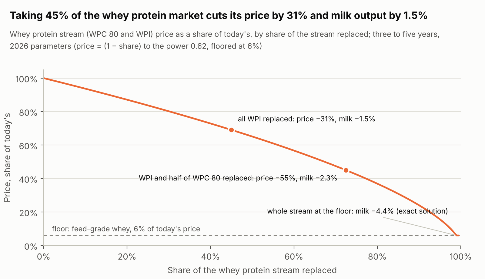

*Figure 8. Price path = (1 − share replaced) to the power 0.62, the whey protein stream's three-to-five-year price response in the model at 2026 parameters; milk effect from the factor of 0.032 at the marks and from the exact solution at the floor; floor from the feed-grade whey quote (section 3)*

### 6.3 The fed steer

On the fed steer the whole-cut and minced streams carry comparable factors because the carcass is a single fixed bundle: 0.19 for the middle meats (43% of value), 0.13 for grinding material (25%), 0.11 for end-meat roasts and steaks, and 0.001 to 0.006 for hide, tallow, offal and meals. The bundle factor is 0.45 after three to five years and 0.13 within a year with a fed-cattle supply elasticity of 0.80 and 0.15. Per kilogram replaced, a kilogram of steak displaces 0.92 kg of live steer and a kilogram of grinding material 0.57 kg; the difference is the value share. A plant-based mince that takes 10% of fed-cattle grinding demand lowers trim prices by 10% and fed-cattle output by 1.3%; the price of the middle meats rises by 1.3% in the same equilibrium.

| Fed steer product | Share of animal value | DF within a year | DF 3–5 years (80% range) | DF constant-cost limit | Stream price change for a 10% replacement | Change in fed cattle if the product's market is lost: 3–5 years; constant-cost limit |
| --- | --- | --- | --- | --- | --- | --- |
| Middle meats (rib, loin steaks and roasts) | 43.4% | 0.056 | 0.190 (0.129–0.265) | 0.419 | −8.1% | −22%; −41% |
| End-meat whole-muscle (chuck, round) | 21.9% | 0.032 | 0.106 (0.060–0.176) | 0.235 | −8.2% | −10%; −22% (share of the stream) |
| Grinding material (trim, ground chuck and round) | 24.6% | 0.038 | 0.127 (0.082–0.176) | 0.279 | −10.3% | −8.4%; −19% |
| Thin-meat whole-muscle (brisket, flank, skirt) | 4.1% | 0.006 | 0.020 (0.011–0.033) | 0.044 | −1.5% | −2.0%; −4.0% (share of the stream) |
| Edible offal | 3.2% | 0.002 | 0.006 (0.003–0.010) | 0.013 | −2.1% | −0.9%; −1.9% (share of the stream) |
| Tallow and technical fat | 1.5% | 0.001 | 0.003 (0.001–0.005) | 0.006 | −1.0% | −0.4%; −0.9% (share of the stream) |
| Hide | 0.7% | 0.000 | 0.001 (0.001–0.002) | 0.003 | −0.5% | −0.2%; −0.4% (share of the stream) |
| Meat and bone meal, blood meal | 0.6% | 0.000 | 0.001 (0.000–0.002) | 0.002 | −0.4% | −0.1%; −0.3% (share of the stream) |
| All products together (bundle) | 100% | 0.135 | 0.453 (0.343–0.588) | 1.000 |  |  |

The fed-steer factors overstate the effect of a mince replacement on US cattle because mince is the residual sink of the whole system. Ground beef was about 48% of US beef consumption by volume in 2025 and is assembled from fed-cattle trim, from cull cows (dairy and beef, close to 100% ground) and from imported lean trim, which supplied 39% of the trim ground in 2025 ([Peel 2026](http://www.oklahomafarmreport.com/2026/04/27/cow-calf-corner-dr-derrell-peel-the-hamburger-story/)). Foreign manufacturing beef is a primary product in exporting countries and its supply to the US market is elastic, so a demand loss in ground beef falls first on imports and on the trim price, and only then on domestic cattle. A weighted composite, taking 41% of ground beef from fed cattle at a factor of 0.13, 20% from cull cows at 0.02 and 39% from imports at close to 0 for US cattle, gives a three-to-five-year factor of about 0.06 US cattle-equivalents per unit of ground beef replaced.

### 6.4 The laying hen

Shell eggs decide the laying hen; separated white has almost no effect on it. At 2019 to 2021 price relationships, shell eggs are 83% of the hen's revenue and 68% of her eggs and carry a three-to-five-year factor of 0.46; whole liquid egg carries 0.14; separated white 0.030 and separated yolk 0.048; the spent hen 0.0001. The egg-product factors are higher than their value shares because eggs are allocated by volume: the breaking plant takes 32% of eggs for 17% of the value. Losing the whole separated-white market, with liquid white at its floor of about a third of today's price, removes 3.0% of laying hens after three to five years and 4.4% in the constant-cost limit; within a year, with an egg supply elasticity of 0.03, it removes 0.3%. Losing the shell-egg market removes 44% and 68%.

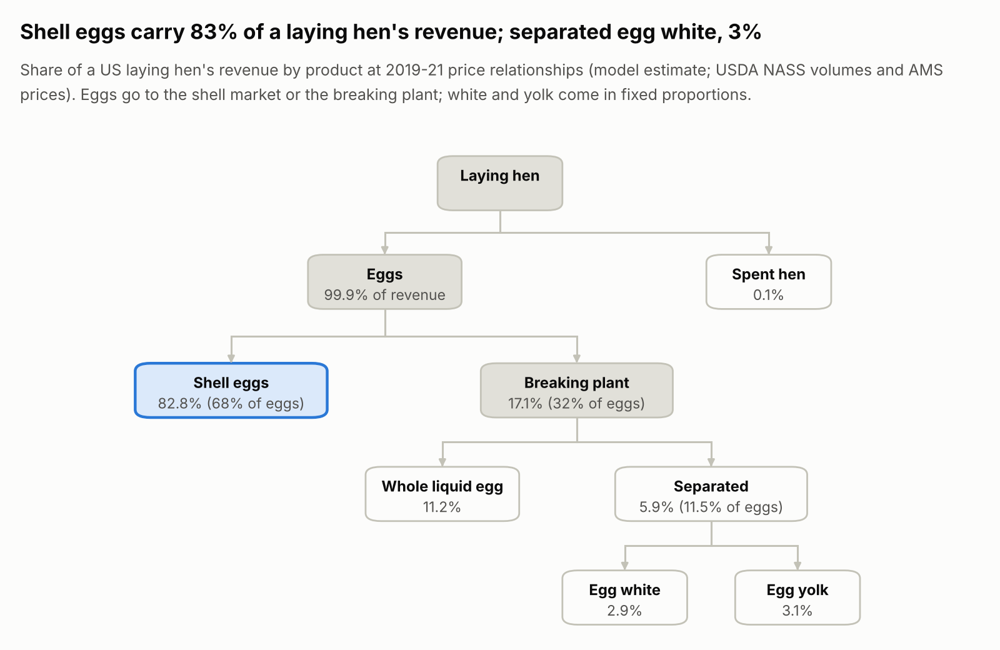

*Figure 9. Joint products of a US laying hen: eggs are allocated between the shell market and the breaking plant, and white and yolk are joint; shares from the model at 2019–21 price relationships (USDA NASS egg products volumes, AMS prices, egg grading manual composition)*

| Layer product | Share of animal value | DF within a year | DF 3–5 years (80% range) | DF 3–5 years, Sep 2025 prices | DF constant-cost limit | Stream price change for a 10% replacement | Change in hens if the product's market is lost: 3–5 years; constant-cost limit |
| --- | --- | --- | --- | --- | --- | --- | --- |
| Shell eggs | 82.8% | 0.040 | 0.458 (0.358–0.530) | 0.460 | 0.680 | −4.6% | −44%; −68% |
| Whole liquid and frozen egg | 11.2% | 0.012 | 0.138 (0.108–0.160) | 0.139 | 0.205 | −1.4% | −15%; −20% |
| Separated egg white (liquid, dried albumen, protein fractions) | 2.9% | 0.003 | 0.030 (0.016–0.045) | 0.019 | 0.044 | −4.3% | −3.0%; −4.4% |
| Separated egg yolk | 3.1% | 0.004 | 0.048 (0.029–0.063) | 0.059 | 0.071 | −4.4% | −3.7%; −5.5% |
| Spent hen | 0.1% | 0.000 | 0.000 (0.000–0.000) | 0.000 | 0.000 | −2.0% | n/a (no market price) |
| All products together (bundle) | 100% | 0.058 | 0.673 (0.526–0.780) | 0.677 | 1.000 |  |  |

Two structural points explain the egg-white result. The first is that most egg white is never separated: it is eaten in shell eggs (68% of table eggs) and in whole liquid egg (two thirds of the broken eggs), so an albumen protein that replaces separated white competes in a market worth 3% to 4% of the hen. An albumen protein that replaces whole liquid egg in bakery and foodservice competes in the 11% to 15% market and inherits a factor of 0.14, and one that replaces the shell-egg occasion inherits 0.46. The second is that white and yolk are joint: a 10% loss of white demand raises the price of yolk by about 3.5% in the model, because fewer eggs are separated, and the breaker's margin on the pair is what moves. The protein fractions inside the white (ovalbumin 54%, ovotransferrin 12%, ovomucoid 11%, lysozyme 3.5% of albumen protein, [Abeyrathne, Lee & Ahn 2013](https://lib.dr.iastate.edu/ans_pubs/885/)) are a further level of the same structure: lysozyme is extracted commercially and the rest of the white is sold on, so the displacement factor of a single fraction is its share of the white's value multiplied by 0.030.

The 2025 column shows how far the egg-white share moves with the cycle. In the tight market after avian influenza the separated white and yolk together were 14% of the hen's value against 6% in 2019 and dried albumen reached $24 per lb, yet the white's factor fell to 0.019, because yolk took most of the separated route's value and the white's weight inside it fell. Those prices were rents on a supply that the flock rebuild has since removed: by October 2026 shell eggs were at $0.43 per dozen and breaking stock at $0.08 ([USDA egg markets overview](https://www.ams.usda.gov/mnreports/ams_3725.pdf)).

Nothing happens to the meat of a laying hen, because it has no price. Spent hens are quoted as a removal cost of 0 to 5 cents per bird; around a quarter go through inspected slaughter for soups, pet food and processed meat and the rest are rendered or composted (Freeman et al. 2009; [USDA AMS fowl market](https://www.ams.usda.gov/mnreports/pywfowl.pdf)). A novel chicken meat does not touch the layer system and a novel egg does not touch the broiler system; the two use different genetics, housing and economics, and the only link is the rendering outlet they share.

### 6.5 The broiler and processed chicken

Processed chicken shows the dynamic, and the raw material decides which factor applies. A nugget made from whole-muscle breast and rib meat, as the leading quick-service product is ([McDonald's and Tyson, 2014](https://abc7ny.com/food/whats-really-inside-mcdonalds-chicken-mcnuggets/431543/)), is a use of breast meat and carries the breast factor of 0.23; a nugget or hot dog made from mechanically separated chicken is a use of backs, necks and frames at $0.125 per lb and carries a factor of 0.003. The two differ by a factor of about 80. A plant-based or mycoprotein nugget priced against the store-brand product therefore competes with the cheapest material on the bird, whose floor is rendering, while one priced against whole-muscle nuggets competes with the product that keeps broilers in production. Further processing is now 52% of US broiler marketings ([National Chicken Council](https://www.nationalchickencouncil.org/statistic/how-broilers-are-marketed)), so the distinction covers a large market.

| Broiler product | Share of animal value | DF within a year | DF 3–5 years (80% range) | DF constant-cost limit | Stream price change for a 10% replacement | Change in broilers if the product's market is lost: 3–5 years; constant-cost limit |
| --- | --- | --- | --- | --- | --- | --- |
| Boneless skinless breast (fillets, whole-muscle nuggets) | 45.2% | 0.051 | 0.230 (0.116–0.369) | 0.549 | −7.4% | −25%; −52% (share of the stream) |
| Tenders | 9.6% | 0.011 | 0.049 (0.024–0.078) | 0.116 | −1.6% | −5.3%; −11% (share of the stream) |
| Wings | 19.9% | 0.018 | 0.081 (0.035–0.152) | 0.194 | −9.2% | −8.6%; −19% |
| Whole legs / leg quarters (dark meat) | 16.3% | 0.010 | 0.044 (0.019–0.086) | 0.106 | −6.4% | −5.1%; −12% |
| Paws and giblets | 5.4% | 0.002 | 0.011 (0.005–0.022) | 0.026 | −1.5% to −3.4% | −1.9%; −4.4% |
| Backs, necks, frames (mechanically separated chicken) | 2.1% | 0.001 | 0.003 (0.001–0.006) | 0.007 | −3.3% | −0.4%; −1.0% |
| Feathers, blood, viscera (rendering) | 1.5% | 0.000 | 0.001 (0.001–0.002) | 0.003 | −2.0% | −0.6%; −1.4% |
| All products together (bundle) | 100% | 0.093 | 0.419 (0.229–0.661) | 1.000 |  |  |

A 10% replacement of breast meat lowers the breast price by 7.4%, lowers broiler output by 2.3% after three to five years, and raises the prices of wings by 2.3% and of leg quarters by 1.5%, because fewer birds means fewer of every part. Dark meat carries a lower factor than its 16% value share would suggest because it is export-exposed and elastic; the US leg quarter price is set in Mexico, Cuba and Angola as much as at home. Losing the whole breast-and-tenders stream removes 30% of broilers after three to five years and 63% in the constant-cost limit (25% and 52% for boneless breast alone), with wings rising 43% in price; losing the mechanically separated chicken market removes 0.4%.

### 6.6 The hog

Pork is the branch where the whole-cut versus processed distinction matters least, because the processed primals are primary products. Bacon comes from the belly and cured ham from the ham, and those two primals are 41% of carcass weight and 39% of carcass value; their factors, 0.12 and 0.17 after three to five years, are in the same range as the loin's 0.15. The residual stream, the picnic, jowl, neck bones and trim that become sausage and ground pork, is 10% of value and carries 0.047 with a floor at pet food. Between 62% and 74% of US pork is eaten processed ([Davis & Lin 2005](https://ers.usda.gov/sites/default/files/_laserfiche/outlooks/37377/15778_ldpm13001_1_.pdf?v=75163); National Pork Board), so a plant-based bacon or deli ham competes with a primary product and a plant-based sausage with the residual.

| Hog product | Share of animal value | DF within a year | DF 3–5 years (80% range) | DF constant-cost limit | Stream price change for a 10% replacement | Change in hogs if the product's market is lost: 3–5 years; constant-cost limit |
| --- | --- | --- | --- | --- | --- | --- |
| Loin (chops, roasts) | 23.1% | 0.071 | 0.146 (0.103–0.188) | 0.234 | −4.4% | −15%; −21% (share of the stream) |
| Ham (mostly cured) | 22.3% | 0.083 | 0.169 (0.095–0.269) | 0.271 | −11.1% | −14%; −22% |
| Belly (bacon) | 16.5% | 0.057 | 0.117 (0.078–0.158) | 0.188 | −11.0% | −9.8%; −15% |
| Butt (shoulder, pulled pork) | 11.8% | 0.037 | 0.075 (0.053–0.096) | 0.120 | −2.2% | −7.5%; −11% (share of the stream) |
| Spareribs | 8.0% | 0.025 | 0.050 (0.036–0.065) | 0.081 | −1.5% | −5.1%; −7.4% (share of the stream) |
| Picnic, jowl, neck bones, trim (sausage, ground pork) | 10.0% | 0.023 | 0.047 (0.025–0.083) | 0.076 | −7.9% | −4.0%; −6.4% |
| Drop credit (lard, offal, meals, plasma) | 7.0% | 0.008 | 0.016 (0.008–0.028) | 0.025 | −3.3% | −2.4%; −3.7% (share of the stream) |
| Feet, tails | 1.2% | 0.001 | 0.003 (0.001–0.005) | 0.004 | −0.6% | −0.4%; −0.6% (share of the stream) |
| All products together (bundle) | 100% | 0.305 | 0.622 (0.524–0.728) | 1.000 |  |  |

The hog's within-a-year factors are the highest of any land animal because hog supply responds within a year (elasticity 0.40 against 0.15 for cattle and 0.10 for broilers), and the gap between the horizons is the smallest. The pork cutout of September 2026 also shows how far relative prices move inside a carcass: the loin primal at $0.88 per lb was below 72% lean trim at $1.09 ([USDA AMS pork report](https://s3.amazonaws.com/barchart-news-store-prod/external_links/USDA/20261009-lsddhps.pdf)), so for a few weeks the chop was cheaper per pound than the leanest grinding material, although the sausage stream as a whole, picnics and jowls included, still averaged $0.66. Factors computed on that snapshot shift accordingly, and the workbook's inputs are there to be updated.

### 6.7 Wild and farmed fish

Processed fish shows the dynamic twice over. Fish fingers, breaded fillets and surimi seafood are made from the cheapest abundant whitefish, Alaska pollock above all: in the United Kingdom pollock is 93% frozen and sold almost entirely in coated formats at £5 to £6 per kg against £11 to £13 for cod ([Seafish 2025](https://www.seafish.org/media/jqopmymk/frozen-seafood-in-multiple-retail-factsheet-2025.pdf)). The pollock fishery is managed under a total allowable catch, so its supply elasticity is close to zero at any horizon. A plant-based fish finger that takes 10% of pollock fillet demand lowers fillet block prices by about 5%, shifts some flesh from blocks to surimi, and reduces the catch by 0.2% on a long-run supply elasticity of 0.05 and by nothing on a binding quota. The catch is all but unchanged; the replacement changes who eats the fish and at what price.

| Alaska pollock product | Share of animal value | DF within a year | DF 3–5 years (80% range) | DF constant-cost limit | Stream price change for a 10% replacement | Change in catch if the product's market is lost: 3–5 years; constant-cost limit |
| --- | --- | --- | --- | --- | --- | --- |
| Fillet blocks and fillets (fish fingers, portions) | 47.0% | 0.000 | 0.020 (0.007–0.063) | n/a (quota) | −5.1% | −4.5%; n/a (share of the stream) |
| Surimi (crab sticks) and mince | 28.7% | 0.000 | 0.013 (0.004–0.039) | n/a (quota) | −0.2% to −2.9% | −2.7%; n/a (share of the stream) |
| Roe | 7.8% | 0.000 | 0.004 (0.001–0.013) | n/a (quota) | −10.0% | −0.3%; n/a |
| Fishmeal and fish oil | 11.6% | 0.000 | 0.001 (0.000–0.004) | n/a (quota) | −0.7% to −1.3% | −0.6%; n/a |
| Headed and gutted | 5.0% | 0.000 | 0.002 (0.001–0.007) | n/a (quota) | −0.5% | −0.5%; n/a (share of the stream) |
| All products together (bundle) | 100% | 0.000 | 0.040 (0.015–0.122) | n/a (quota) |  |  |

Farmed fish behaves like a land animal. Norwegian salmon is 97% flesh by value and 3% by-products, so the fillet carries a three-to-five-year factor of 0.44 and the heads, frames and trimmings that become oil, meal and pet food carry 0.004. The within-a-year factor is 0.09, because salmon supply within a cycle is set by the biomass already in the pens (Asheim et al. 2011); the five-year value depends on whether licensed biomass is binding, which in Norway it is, and a looser licence regime would raise it toward the 1.4 to 1.6 estimated for the 1990s. Fishmeal and fish oil are by-products at two levels: 34% of fishmeal and 54% of fish oil came from by-products in 2024 ([IFFO](https://www.iffo.com/product)), and the rest comes from reduction fisheries whose catch is set by quota and biology. A substitute for fishmeal lowers the fishmeal price and the by-product credit of the fillet industry; whether it reduces the catch of forage fish depends on the supply response of those fisheries, which the literature puts between slightly negative and 0.5.

| Farmed salmon product | Share of animal value | DF within a year | DF 3–5 years (80% range) | DF constant-cost limit | Stream price change for a 10% replacement | Change in salmon if the product's market is lost: 3–5 years; constant-cost limit |
| --- | --- | --- | --- | --- | --- | --- |
| Salmon fillets and portions | 97.0% | 0.088 | 0.435 (0.200–0.698) | 0.990 | −5.6% | −89%; −100% |
| By-products (heads, frames, trimmings) | 3.0% | 0.001 | 0.004 (0.002–0.009) | 0.010 | −3.3% | −0.9%; −2.1% |
| All products together (bundle) | 100% | 0.089 | 0.439 (0.203–0.706) | 1.000 |  |  |

### 6.8 Price caps: the product-exit and animal-exit regimes

The factors above describe replacement at the margin. The table gives the exact solution for a perfect substitute offered at a fixed share of today's price, after three to five years and, at a 50% discount, in the constant-cost limit. The last column gives the threshold below which a product that is the sole output of a fungible route loses the raw commodity entirely.

| Product (animal) | Animal change, substitute at 90% of today's price | at 75% | at 50% | at 25% | Substitute's share of the market at 50% | Animal change at 50%, constant-cost limit | Price below which the raw commodity leaves the product entirely (3–5 years) |
| --- | --- | --- | --- | --- | --- | --- | --- |
| Cheese (dairy cow) | −4.1% | −9.8% | −18% | −24% | 61% | −38% | no threshold (joint products carry the route) |
| Fluid milk (dairy cow) | −7.5% | −10% | −10% | −10% | 100% | −17% | 87% of today's price |
| Whey protein, WPC 80 and WPI (dairy cow) | −0.5% | −1.3% | −2.5% | −3.6% | 67% | −4.2% | no threshold (joint products carry the route) |
| Shell eggs (laying hen) | −10.0% | −25% | −44% | −44% | 100% | −68% | 56% of today's price |
| Whole liquid egg (laying hen) | −10.0% | −15% | −15% | n/a (cap below the floor) | 100% | −20% | 85% of today's price |
| Separated egg white (laying hen) | −0.6% | −1.5% | −2.5% | n/a (cap below the floor) | 75% | −3.7% | no threshold (joint products carry the route) |
| Breast meat and tenders (broiler) | −3.1% | −7.7% | −15% | −23% | 51% | −46% | not applicable (carcass part) |
| Mechanically separated chicken (broiler) | −0.1% | −0.2% | −0.4% | n/a (cap below the floor) | 88% | −1.0% | not applicable (carcass part) |
| Middle meats (fed steer) | −2.3% | −5.8% | −11% | −17% | 56% | −26% | not applicable (carcass part) |
| Grinding material (fed steer) | −1.2% | −3.1% | −6.0% | n/a (cap below the floor) | 48% | −14% | not applicable (carcass part) |
| Loin, butt, ribs (hog) | −3.3% | −7.9% | −15% | −21% | 54% | −25% | not applicable (carcass part) |
| Ham (hog) | −1.5% | −3.7% | −7.3% | −11% | 45% | −12% | not applicable (carcass part) |
| Belly (hog) | −1.0% | −2.6% | −5.1% | −7.5% | 45% | −8.4% | not applicable (carcass part) |
| Salmon fillets (farmed salmon) | −7.8% | −20% | −41% | −63% | 70% | −100% | not applicable (carcass part) |
| Pollock flesh (wild pollock) | −0.4% | −1.1% | −2.5% | −4.5% | 55% | n/a (quota) | not applicable (carcass part) |

Three things stand out. A substitute for a carcass part or for cheese takes share smoothly and the animal responds in proportion: a casein cheese at 75% of today's cheese price takes 34% of the cheese market and removes 10% of milk output after three to five years; at 50% it takes 61% and removes 18%, or 38% in the constant-cost limit, and whey protein prices rise by 46% on the way. A substitute for a by-product takes most of the market for a small effect on the animal: whey protein at half today's price goes to a 67% substitute share and 2.5% less milk, and at the feed-grade floor to 99% and 4.4%. And a substitute for a product that is the sole output of a fungible route pins the price of the whole raw commodity until it crosses the threshold, after which the route closes: a shell-egg substitute at 90% of the shell price lowers the value of every egg by 10% and the flock by 10%, because breakers pay the shell price less a margin; at 75% it takes 35% of the shell market and the flock falls 25%; below 56% all eggs go to the breaking plant, the substitute has the whole shell market, and the flock is sized by the breakers' demand, 44% smaller than today. Fluid milk behaves the same way with a threshold at 87% of the Class I value, because milk is worth almost as much in cheese.

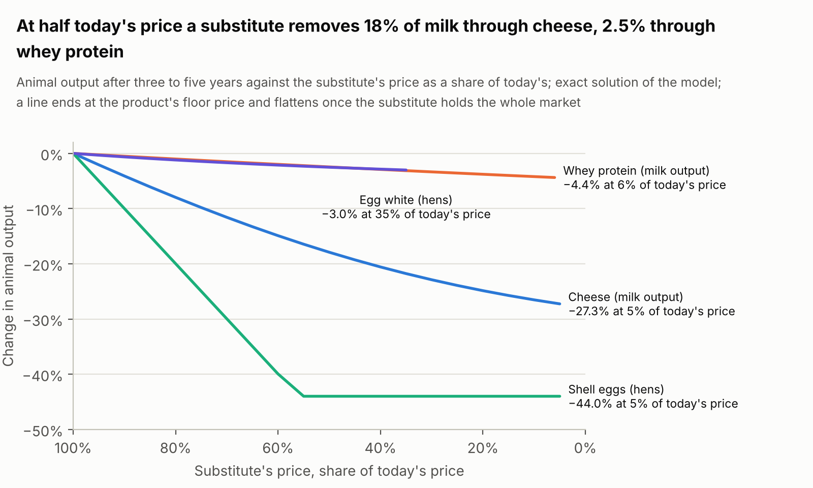

*Figure 10. Change in animal output after three to five years when a perfect substitute caps the price of one product at a share of today's level; exact non-linear solution of section 4.3; a curve flattens once the substitute holds the whole market*

The animal-exit regime needs the whole bundle. A perfect substitute for every product of an animal at a share π of today's prices leaves π to the power ε\_s of the animals after three to five years and none in the constant-cost limit.

| Animal | Substitute for every product at 90% of today's prices | at 75% | at 50% | at 25% | Constant-cost limit, any discount |
| --- | --- | --- | --- | --- | --- |
| Dairy cow | −9.0% | −23% | −46% | −71% | −100% |
| Fed steer | −8.1% | −21% | −43% | −67% | −100% |
| Layer hen | −10.0% | −25% | −50% | −75% | −100% |
| Broiler | −7.1% | −18% | −38% | −62% | −100% |
| Hog | −15% | −35% | −65% | −88% | −100% |
| Alaska pollock | −0.5% | −1.4% | −3.4% | −6.7% | n/a (quota) |
| Farmed Atlantic salmon | −8.1% | −21% | −43% | −67% | −100% |

The hog's supply elasticity of 1.5 makes it the fastest to leave and the broiler's 0.7 the slowest, the order the bundle factors give except that hogs move ahead of laying hens. The power law extrapolates a constant supply elasticity to price cuts far outside the range over which it was estimated, so the 50% and 25% columns should be read as illustrations. The constant-cost column is the whale-oil case: once a cheaper perfect substitute exists for everything the animal sells, nothing on the demand side keeps it, and the only question is how long the fixed factors take to leave.

### 6.9 How robust the numbers are

The 80% ranges in the tables come from the sampling described in section 5. For the primary products the range is roughly ×/÷1.4 around the point value, wider for broilers: cheese 0.18 to 0.37, chicken breast 0.12 to 0.37, shell eggs 0.36 to 0.53, beef middle meats 0.13 to 0.27. For the assumed by-product elasticities the range is wider in proportion, about ×/÷1.8: WPI at 2026 prices 0.007 to 0.026, separated egg white 0.016 to 0.045, mechanically separated chicken 0.001 to 0.006. The bundle factors range from 0.38 to 0.75 for dairy, 0.23 to 0.66 for broilers, 0.53 to 0.78 for eggs, 0.34 to 0.59 for fed cattle, 0.52 to 0.73 for hogs and 0.20 to 0.71 for salmon, almost entirely from the supply elasticity. In every draw the primary product of each animal carries a higher factor than any of its by-products; the largest by-product factor is below a tenth of the primary product's in nine draws out of ten for every animal except the hog, where the drop credit reaches a fifth of the loin's, and no by-product factor exceeds 0.08 in any draw. The order of the secondary products within an animal does change between draws, because their point values are close and their elasticities are drawn independently.

## 7. What price parity means for a novel ingredient

Price parity is usually stated as one number, the current price of the animal product the novel ingredient replaces. The joint-production structure turns it into three. Entry parity is parity with today's price and decides whether a buyer will switch at all. Sustained parity is parity with the price the animal product will have after the novel ingredient has taken share, which is lower, and for a by-product falls toward its floor. Displacement parity is the fall in the farm price at which animals leave the system; it is set by the animal's supply elasticity, and the share of a product that must be replaced to bring it about is the target divided by that product's factor.

The benchmark also depends on the unit. Animal proteins are priced per kilogram of product, and the processed fractions are concentrated, so a comparison per kilogram of protein gives a different ranking from a comparison per kilogram of product. The table converts the prices used in this paper to dollars per kilogram of protein.

| Product (price basis, date) | Price per kg of product | Protein content | Price per kg of protein |
| --- | --- | --- | --- |
| Fishmeal (World Bank, 2024–25 average) | $1.70 | 65% | $2.6 |
| Mechanically separated chicken (USDA, Oct 2026) | $0.52 | 14% | $3.7 |
| Liquid egg white (USDA, Oct 2019) | $0.51 | 11% | $4.6 |
| Liquid whole egg (USDA, Oct 2019) | $0.73 | 12.5% | $5.8 |
| Chicken leg quarters (USDA, Jan 2025) | $1.13 | 18% | $6.3 |
| Pork loin (USDA, Sep 2026) | $1.94 | 21% | $9.2 |
| Nonfat dry milk (USDA, Sep 2026) | $3.94 | 36% | $11.0 |
| Acid casein (USDA Dairy Market News, Oct 2026) | $10.1 | 90% | $11.3 |
| Dry whey (USDA, Sep 2026) | $1.48 | 12% | $12.3 |
| Fluid milk at Class I farm value (Oct 2026) | $0.42 | 3.3% | $12.6 |
| Dried egg white (USDA, Oct 2019) | $10.5 | 82% | $12.9 |
| Cheddar cheese (USDA, Sep 2026) | $3.43 | 25% | $13.7 |
| Chicken breast, boneless (USDA, Jan 2025) | $3.28 | 23% | $14.2 |
| Pork belly (USDA, Sep 2026) | $2.13 | 12% | $17.8 |
| WPC 80 (USDA Dairy Market News, Oct 2026) | $20.9 | 80% | $26 |
| Pollock fillet blocks (2024–26 trade prices) | $4.50 | 17% | $26 |
| WPI (USDA Dairy Market News, Oct 2026) | $30.9 | 90% | $34 |
| Farmed salmon, head-on gutted (Norway, 2026) | $7.5 | 20% | $37 |
| Beef 90% lean trim (USDA, Oct 2026) | $8.79 | 19% | $46 |
| Dried egg white (USDA, Jul 2025) | $52.9 | 82% | $64 |
| Beef rib and loin primals (USDA, Oct 2026) | $11.7 | 17% | $69 |

The cheapest animal proteins are the ones with no food demand of their own: fishmeal, mechanically separated chicken, surplus egg white. The commodity dairy proteins, nonfat dry milk, casein and dry whey, cluster at $11 to $13 per kg of protein, which is the price of milk protein as such; fluid milk, cheese and pork belly land nearby only because the table credits their fat to protein. And the dearest proteins in the list, whey protein isolate at 2026 prices, dried egg white after avian influenza, lean beef trim and middle meats, are a mix of scarcity rents on fixed by-product supplies and the price of muscle structure.

Fermentation cost estimates sit inside this range. The meta-analysis of published techno-economic models by [GFI (2025)](https://gfi.org/fd-tea-pdf) gives costs of production for precision-fermented food proteins from $11 per kg upward at scale, with parity targets of $8 to $18 per kg for whey proteins and $8 to $11 per kg for casein; [GFI Europe and Arthur D. Little (2025)](https://gfieurope.org/wp-content/uploads/2025/07/Pathfinding-towards-precision-fermentation-viability.pdf) model a base case of $24 per kg for alpha-lactalbumin falling to $12 with improvements in titer, yield, substrate cost and vessel size, against benchmarks of $11 to $17 per kg for beta-lactoglobulin, $12 for ovalbumin and $7 for casein. A precision-fermented whey protein at $15 per kg therefore has entry parity against WPI at $31 per kg in October 2026 and had none against WPI at $11 per kg in 2019; the difference between the two years is rent.

Sustained parity follows the price path of section 6.2: a whey protein that takes the isolate market has to hold at 69% of today's price, one that takes isolate and half the concentrate at 45%, one that takes the stream at the feed-grade floor. The price-cap solutions of section 6.8 give the same answer from the other side. A perfect substitute at half today's price takes two thirds of the whey protein market, because the lower price expands demand and the cow's whey still has to be sold; the animal product does not leave at any price above the floor.

Displacement parity is a different calculation. To remove a share T of the animals after three to five years, the farm price of the raw commodity has to fall by T divided by the supply elasticity: 5.6% of the milk price for a 5% reduction in milk output. Working back through the joint-product structure, 5% less milk requires an 18% reduction in cheese demand at a cheese price 12% below today's, or a perfect cheese substitute at 87% of today's price, or a perfect fluid-milk substitute at 93%. It cannot be reached through whey protein at all: a whey protein substitute at the feed-grade floor removes 4.4% of milk output at 2026 prices and 1.0% at 2019 prices.

Minced beef shows the same logic on the meat side. A plant-based mince at retail parity with ground beef ($6.79 per lb in September 2026, [BLS](https://fred.stlouisfed.org/series/APU0000703112)) that takes 10% of grinding demand lowers trim and grinding-chuck prices by about 10% and fed-cattle numbers by 1.3% after three to five years on the model's fed-steer parameters. The grinding stream is also fed by dairy cull cows, where the same 10% removes 0.2% of milk output, and by imported lean trim, 39% of the trim ground in the United States in 2025 ([Peel 2026](http://www.oklahomafarmreport.com/2026/04/27/cow-calf-corner-dr-derrell-peel-the-hamburger-story/)), which comes from foreign grass-fed systems with elastic supply and absorbs the shock first. A rough composite is a displacement of about 0.06 US cattle-equivalents per unit of ground beef replaced after three to five years, and about 0.02 within a year.

## 8. The biotech paradox

The fractions of an animal that biotechnology can reproduce most readily are the fractions that matter least for how many animals exist. Precision fermentation makes single proteins: beta-lactoglobulin, casein, ovalbumin, lactoferrin, collagen. Biomass and gas fermentation make protein-rich mince and flour. Cultivated cells make fat and unstructured tissue first and whole cuts last. The animal industry already fractionates its output (whey from cheese, white from yolk, trim from steak, frames from fillet) and sells each fraction into the market that will take it. The purified fractions biotechnology reaches first are therefore already on the market as processed co-products of a primary product, priced at the cost of separating them plus whatever rent their demand allows, with a floor at the next-best use.

The paradox has two halves. The first is the processing paradox: value is concentrated by processing, but animal-dependence is not. Whey protein isolate is 90% protein and the dearest protein the cow produces, yet the cow is kept for the cheese and the milk; take the isolate away and the protein goes back into WPC, dry whey or feed while the cow stays. The second is the entry paradox: the price that makes a fraction attractive to replace is a scarcity rent on a supply the animal fixes, so it is also the price that disappears on entry. Whey protein at $26 to $34 per kg of protein in 2026 is the strongest commercial case for precision-fermented dairy protein and a target that moves when hit.

The table lines up each product's technical reachability, as judged here from the state of the technologies, against its factor from the model. The ranking is inverse for the dairy and egg fractions and for the rendering streams. Mince and whitefish fillets are the exceptions: reachable products that carry a quarter to a half of the animal's value, and in the case of pollock a quota that fixes the catch.

| Product | Biotech route most able to replace it | Reachability | Share of animal value | DF, 3–5 years | Animal change if the product's market is lost (3–5 years, exact) |
| --- | --- | --- | --- | --- | --- |
| WPI, WPC 80 (whey protein) | precision fermentation (beta-lactoglobulin) | high | 12.6% (2026); 3.3% (2019) | 0.015–0.018; 0.004 | −4.4% milk (2026); −1.0% (2019) |
| Separated egg white | precision fermentation (ovalbumin and other albumen proteins) | high | 2.9% (2019); 4.4% (2025) | 0.030; 0.019 | −3.0% hens; −1.9% |
| Mechanically separated chicken (backs, necks) | plant-based and mycoprotein nuggets, hot dogs | high | 2.1% | 0.003 | −0.4% broilers |
| Beef grinding material (trim, ground chuck) | plant-based and mycoprotein mince, blends | high | 24.6% | 0.13 | −8.4% fed cattle |
| Pork sausage material (picnic, trim) | plant-based sausage, blends | high | 10.0% | 0.047 | −4.0% hogs |
| Fishmeal, fish oil, rendering streams | single-cell protein, insect meal, algal oil | high | 1–12% | 0.001–0.004 | under 1% |
| Hides, tallow, lard | mycelium leather, fermentation fats, oleochemicals | high | 1–7% | 0.001–0.016 | under 2.5% |
| Pollock fillet blocks (fish fingers) | plant-based and mycoprotein fish fingers | high | 47% | 0.02 (quota) | −4.5% catch at most |
| Chicken breast | plant-based, mycoprotein, cultivated | medium | 45.2% | 0.23 | −25% broilers |
| Fluid milk | plant-based, precision-fermented whey and casein | medium | 17.4% | 0.10 | −10% milk |
| Whole liquid egg | plant-based liquid egg, precision-fermented albumen | medium | 11.2% | 0.14 | −15% hens |
| Shell eggs | plant-based liquid egg, precision-fermented albumen | low to medium | 83% (2019) | 0.46 | −44% hens |
| Cheese | precision-fermented casein with plant fat | low to medium | 40% | 0.28 | −28% milk |
| Farmed salmon fillets | cultivated, plant-based | low to medium | 97% | 0.44 | −89% salmon |
| Beef middle meats (rib, loin) | cultivated, mycoprotein whole cut | low | 43% | 0.19 | −22% fed cattle |
| Pork loin, ham, belly | cultivated, plant-based whole cut | low to medium | 23%, 22%, 17% | 0.15, 0.17, 0.12 | −15%, −14%, −10% hogs |

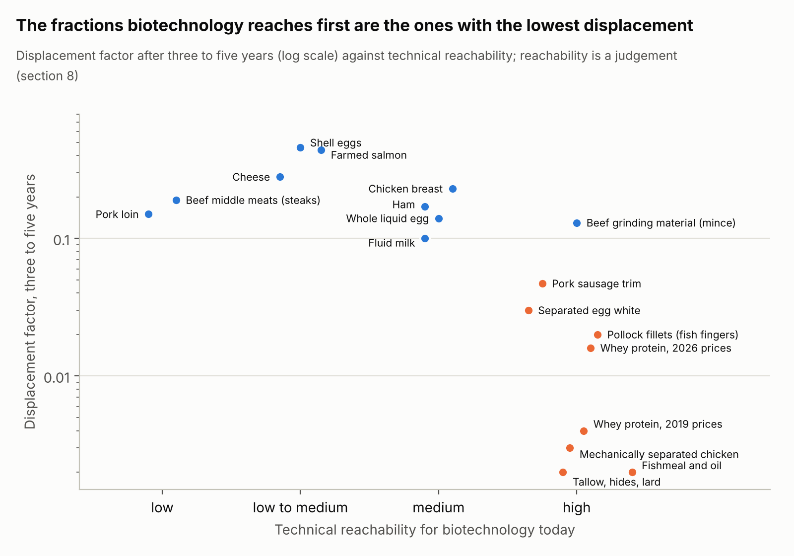

*Figure 11. Displacement factors after three to five years (section 6) against reachability as judged in the table above*

The pattern follows from how the industry works. A fraction is easy for biotechnology because it is chemically simple, and it is chemically simple because it has been separated from the structure of the animal; separation is what the animal industry does to its lowest-value material to find a buyer for it.

Two qualifications apply. The first is that the exceptions are the strategies that use the fraction to make the primary product. Precision-fermented casein that forms micelles and makes cheese inherits the factor of cheese, 0.28, in place of the ingredient factor of casein, about 0.04. Plant protein and cultivated fat that make a mince inherit the grinding-material factor, 0.13 on the fed steer. Albumen proteins and plant proteins that make a liquid whole-egg replacer inherit the whole-egg factor, 0.14, or the shell-egg factor, 0.46, if the replacer reaches the shell-egg occasion. The second is a reminder that co-products cut both ways: a cheese made without cows produces no whey, so a successful casein route would remove the whey stream that the whey protein market is currently built on, raise whey protein prices, and make the cow's remaining products more valuable per cow. The model handles this through the co-product price terms; a 10% loss of cheese demand raises the price of the whey protein stream by about 4% after three to five years before any whey replacement is counted, and the loss of the whole cheese market would more than double it.

The whey case also shows that the paradox has a time dimension. At 2019 prices, whey protein was 3.3% of the cow's value and a substitute at the floor would have removed 1.0% of milk output. At 2026 prices it is 12.6% and 4.4%. The rent that makes 2026 the better year to enter is also the reason the displacement estimate is four times higher, and both revert when the rent does. An analysis that uses the 2026 price to estimate displacement and the 2019 price to estimate parity, or the reverse, is inconsistent; the workbook keeps the two scenarios side by side for that reason.

## 9. Six substitutions and what they did to the animals

The model's mechanism has been tested before, by substitutes that took animal products' markets in the past. Each case below is one of the three regimes of section 4.3, and in each the animal did what the structure of its revenue predicted.

**Kerosene, baleen and the whale.** Petroleum took the lamp-oil market from whale oil after 1859, and by 1908 "petroleum had taken over from whale oil and whalers depended on the sale of whale bone" ([Davis, Gallman and Gleiter, NBER](https://www.nber.org/system/files/chapters/c8277/c8277.pdf)). Whalebone, the baleen used in corsets, brushes and buggy whips, was the co-product: its real price rose from $0.79 per lb in 1866 to $6.03 in 1903, long after the industry's other products had lost their markets, and at the peak the baleen from one bowhead could pay for a voyage. The fleet shrank from more than 208,000 tons in 1846–50 to 10,462 tons in 1901–05, and between 1871–75 and 1901–05 whale oil output fell 93% while whalebone output fell 72%; the Arctic bowhead fishery ran on bone. Then spring steel proved "a superior and cheaper substitute": baleen sold for $5.00 per lb in 1907 and $0.075 in 1912 ([Lee 1983, cited in JAIC 1993](https://cool.culturalheritage.org/jaic/articles/jaic32-03-001_3.html)), and the fishery closed. The oil substitute moved the industry from the first regime to the second, with the animal carried by its remaining product; the bone substitute moved it to the third.

**Synthetics, wool and the Australian sheep.** Synthetic clothing fibres grew through the 1960s and took wool's market share; the Australian flock peaked at 180 million head in 1970 and 170 million in 1990, and the reserve price scheme that had held wool prices collapsed in 1991 with 4.7 million bales in stock ([The Land, 2024](https://www.theland.com.au/story/8991083/the-rise-of-australias-sheep-industry-a-historic-overview); [Australian Wool Reserve Price Scheme](https://en.wikipedia.org/wiki/Australian_Wool_Reserve_Price_Scheme)). The flock fell to about 73 million by 2025, and the sheep that remained were re-bred: Border Leicester and Merino crosses joined to Poll Dorset and White Suffolk rams for prime lambs from the 1990s, Dorpers from 1996, the Australian White from 2011; sheep meat overtook wool as the industry's most valuable export in 2019–20 and Australia became the largest sheep-meat exporter in 2023. This is the second regime for the primary product: wool was the product that decided the sheep, so the flock fell by more than half, and the remainder was carried by the co-product that still paid.

**Margarine and butter.** Between the late 1920s and the early 1950s US per-capita butter consumption halved while margarine consumption tripled, a loss to dairy farmers of about $240 million a year at 1956 prices ([Ladd 1960, via JSTOR Daily](https://daily.jstor.org/is-margarine-dead)). The cow stayed. Milk fat went into cheese, cream and ice cream, and butter is today 3% to 6% of a US dairy cow's revenue depending on the year's prices. A substitute for one use of a fungible raw commodity re-routes the commodity; the herd responds to the average.

**Vegetable shortening and the lard-type hog.** Lard "dropped sharply" as a hog product after the Second World War as hydrogenated vegetable fats took its market, and the industry re-bred the animal: post-war live grading rewarded carcasses with 53% or more of the four lean cuts, carcass grades were introduced in 1952, breeding programmes to reduce fat began in the 1950s, and after the carcass pricing grids of 1992 backfat fell 36% and lean rose from 49.5% to 55.5% of the carcass ([USDA ERS, Pork Quality and the Role of Market Organization, AER-835](https://ers.usda.gov/webdocs/publications/41681/30317_aer835c_002.pdf?v=387.7)). Lard went from co-product to by-product, the drop credit of today's hog, and the hog was redesigned around the cuts that still paid. Second regime again, with the animal's product mix changing in the process, which the model holds fixed.

**Fermentation-produced chymosin and calf rennet.** Chymosin made by genetically modified microbes has been on the market since 1990 and was the first such enzyme the US Food and Drug Administration allowed; by 1999 about 60% of US hard cheese was made with it, and by 2008 80% to 90% of commercial cheese in the United States and Britain, with up to 80% of the global rennet market ([Johnson and Lucey 2006](https://en.wikipedia.org/wiki/Chymosin)). Calf rennet is a by-product of veal slaughter. The calves were unaffected, because they were never kept for their stomachs; the rennet market lost a product that had sold at a scarcity price. This is the precedent for precision-fermented whey or egg proteins: a purified fraction replaced wholesale, at speed, with no effect on the animal.

**Recombinant insulin and the pancreas.** Until 1982 all insulin was extracted from the pancreases of cattle and pigs slaughtered by the meat-packing industry, a supply "limited by and dependent on fluctuation of the demand for meat foods"; Eli Lilly's recombinant human insulin was approved that year ([EBSCO research starter](https://www.ebsco.com/research-starters/health-and-medicine/eli-lilly-releases-first-commercial-genetically-engineered)) and animal-source insulin was withdrawn over the following two decades. The pancreas was a by-product with a scarcity rent; the rent went and the animals stayed.

**Synthetic leather and the hide.** Hides were traditionally 6% to 8% of a steer's value and 58% of its by-product value from 1980 to 2011, peaking at 67% in 2000; by 2019 the share of by-product value was 37%, by April 2020 the hide was about 1% of the animal's value, and some lower-grade hides were going to landfill ([Leather and Hide Council of America, 2020](https://leatherbiz.com/News/154398); [Beef Central, 2019](https://www.beefcentral.com/trade/hides-market-spirals-to-unprecedented-depths/)). Good Australian hides that had been worth up to $110 each in 2014 made $10 to $20 in 2019, and the causes named by the trade were "more convincing synthetic leather products", the luxury car trade, fashion, the closure of small Chinese tanneries and oversupply. In the model's 2026 snapshot the hide is 0.7% of the steer and carries a factor of 0.001. A by-product's price can fall by 90% while the herd does not move at all; the floor, here disposal cost, is where it stops.

The six cases agree with the model on the mechanism and warn about one of its assumptions. Where a substitute took a by-product (rennet, pancreas, hide), the animal was untouched; where it took a primary product (wool, whale oil), the animal was carried by its co-products until those went too; and where it took one use of a fungible commodity (butter), the commodity was re-routed. The warning is that animals are re-bred when their product mix changes, so a substitute that takes a primary product over decades meets an animal whose value shares have moved toward what still pays. The model holds the product mix fixed, which overstates the long-run displacement of a primary product and understates the long-run resilience of the animal.

## 10. Implications for novel ingredients, meat replacements and blends

**For novel ingredients that replace a purified fraction** (whey proteins, casein as an ingredient, albumen proteins, gelatin and collagen, fats, fishmeal and oil):

- Discount replaced volume by the fraction's factor and state the horizon: 0.015 to 0.018 for whey proteins at 2026 prices and 0.004 at 2019 prices, 0.030 for separated egg white at 2019 prices and 0.019 at 2025 prices, about 0.04 for casein and milk powder, under 0.01 for fishmeal, fish oil, hides, tallow and rendering streams, all after three to five years. Within a year the factors are a quarter to a tenth of these; in the constant-cost limit about 1.5 to 2 times.
- Treat the current price as entry parity only. The sustained price is today's price multiplied by (1 − share taken) to the power of the stream's price response, 0.6 for whey protein; the floor for whey protein is about 6% of today's price and for egg white about a third. A perfect substitute at half today's price takes two thirds of the whey protein market and leaves the cow's whey on the market at the lower price.
- Do not expect the animal to leave through the fraction. A substitute that takes the whole US whey protein market at the feed-grade floor removes 4.4% of milk output at 2026 prices and 1.0% at 2019 prices after three to five years, 7.3% and 1.7% in the constant-cost limit; one that takes all separated egg white removes 3.0% of hens, 4.4% in the limit. These are ceilings.
- Use the fraction to make the primary product where the technology allows. Casein that makes cheese inherits 0.28; albumen that makes a whole-egg replacer inherits 0.14 and, if it reaches the shell-egg occasion, 0.46; a whey-and-casein milk inherits 0.10.
- Expect fixed-proportion co-products to tighten. A successful casein cheese removes whey supply and raises whey protein prices; a successful breast-meat substitute raises wing and leg-quarter prices. The remaining products of the animal become more valuable per animal, which partly offsets the displacement.

**For meat replacements:**

- Whole-muscle products carry the highest factors because they are the primary products of the carcass: 0.19 for beef middle meats, 0.23 for chicken breast, 0.15 to 0.17 for pork loin and ham, 0.44 for farmed salmon fillet. They are also the hardest products to replicate technically.
- Minced beef is the residual sink of the cattle system. On the fed steer the grinding stream carries 0.13, but ground beef is assembled from fed-cattle trim, dairy and beef cull cows (0.02 through the dairy cow) and imported lean trim (39% of trim in 2025, elastic foreign supply). A composite factor of about 0.06 US cattle per unit of ground beef replaced after three to five years is a defensible planning figure; within a year it is about 0.02.
- Processed chicken depends on the raw material: 0.23 for whole-muscle nuggets, 0.003 for products made from mechanically separated chicken. The store-brand nugget competes with material whose floor is rendering.
- Processed pork splits the same way: bacon and deli ham are primary products (0.12 to 0.17); sausage and ground pork are the residual (0.047).
- Processed fish from quota-managed stocks carries a factor near zero at any horizon. A fish-finger substitute changes the price and destination of pollock and leaves the catch where the quota sets it. Farmed-fish substitutes behave like land-animal substitutes.
- A substitute that aims at the animal itself has to take the bundle. At 75% of today's prices for every product, 18% of broilers, 21% of fed cattle, 25% of laying hens and 35% of hogs leave after three to five years and milk output falls 23%; all of them leave in the constant-cost limit.

**For blends** (products that replace a share of the animal ingredient with a plant or fermentation ingredient):

- A blend is a demand shift on the animal ingredient it dilutes, scaled by the inclusion rate. A 30% plant inclusion in a mince that takes 10% of the ground beef market is a 3% shift on grinding material and removes 0.4% of fed-cattle output after three to five years, less through the composite above.
- Because blends nearly always dilute the processed or minced fraction, they inherit the residual-stream factors (0.05 to 0.13 at the animal, about 0.06 composite for US beef) however large their market share; the whole-cut factors do not apply to them.
- The price effect of a blend is spread across the whole grinding stream and falls first on imports and trim prices; the ingredient's own price parity is with trim at $2 to $9 per kg depending on lean content; retail ground beef is the wrong benchmark.
- Blends have one advantage the factor does not capture: they move volume at the primary-product occasion (the burger, the sausage) without requiring the structural fidelity of a whole-cut replacement, and a blend that reaches whole-muscle occasions through restructured products would carry the higher factor.

**Across all three:** state the horizon with every displacement figure and report the three where the decision depends on it; use the species bundle rate (0.42 to 0.67 for the farmed animals after three to five years) only for interventions that reduce demand for all of an animal's products at once; name the regime, marginal replacement or a perfect substitute at a price, because the two give different numbers for the same product; and report the price benchmark the parity claim refers to, because for by-products the three benchmarks differ by an order of magnitude.

## 11. What a skeptic would attack, and what the model says

The results rest on choices that a careful reader will want to test. The table lists the ones that matter most, what was done about each, and how much the numbers move; the paragraphs after it take up the three that are not a matter of parameters.

| Challenge | What the model does | What it changes |
| --- | --- | --- |
| The by-product demand elasticities are assumptions | Tagged \[A\]; sampled over ×/÷1.8 for the ranges in section 6; halving and doubling reported here | Whey protein stream: 0.060 at −0.75, 0.032 at −1.5, 0.017 at −3.0. Separated egg white: 0.044, 0.030, 0.018. Mechanically separated chicken: 0.006, 0.003, 0.001. By-product factors stay below 0.07 across the range; the cheese factor moves by 0.02 |
| The horizon drives everything | Three horizons reported for every product; the constant-cost limit is the upper bound | Cheese 0.08, 0.28, 0.49; whey protein 0.009, 0.032, 0.056; the ratio between products is the same at every horizon |
| Prices are a snapshot | Two scenarios for dairy (2019–21 and 2026) and eggs (2019–21 and 2025); meat inputs editable | Whey protein factor 0.008 at 2019 prices and 0.032 at 2026; egg white 0.030 and 0.019; cheese 0.33 and 0.28; shell eggs unchanged |
| Full-replacement figures are extrapolations | Every full-loss and price-cap figure comes from the exact non-linear solution | A linear extrapolation would understate the whey protein full-loss effect (3.2% against 4.4%) and match cheese (28%) |
| Whey protein recovery responds to price | Held fixed at 50% of liquid whey protein; 65% reported here | At 65% recovery the whey protein share is 15.8% and the factor 0.040; if recovery falls when prices fall, the stream behaves even more like a by-product and the factor is lower |
| The fluid milk and shell egg thresholds are knife-edges | They follow from perfect fungibility and proportional route values; in practice route switching has costs and products are differentiated | The thresholds are where the model's route closes; real routes would shrink over a range of prices around 87% (fluid) and 56% (shell eggs) |
| Processing margins are absolute, not proportional | Proportional margins assumed; the make allowances for cheese and whey are absolute | Farm-level demand is less elastic than retail demand under absolute margins (Gardner 1975), so every factor is somewhat higher than reported |
| Cross-price effects between species | Not modelled | A beef substitute raises chicken demand and the reverse; single-species figures overstate the effect on total animal numbers |
| Trade | Imported trim counted in the ground beef composite; export exposure of dark meat and powder through elasticities only | Foreign supply absorbs shocks first; the US figures are upper bounds for products with large import shares and lower bounds for exported streams |
| The animal is re-bred when its product mix changes | Product mix held fixed | Over decades a primary-product substitute meets an animal re-oriented to what still pays, as the hog and the sheep were; long-run displacement of a primary product is overstated |

Three further objections concern what the factor is for.

The first is that a marginal factor is the wrong metric for a technology that aims to take a whole market. It is the wrong metric for that question, which is why section 6.8 answers it with the exact price-cap solutions and the three regimes. For a by-product the two answers agree in direction and differ in size, 0.032 per unit at the margin against 4.4% of the herd for the whole market; for a primary product they diverge, because taking the whole cheese market removes 28% of milk output while the factor describes the first few percent. A reader who wants the animal effect of a product line disappearing should use the full-loss column, and one who wants the effect of a share should use the cap curves.

The second is attribution. If three substitutes enter the same market, the factor applies to their combined share, and dividing the effect between them is a question the model does not answer. The same holds across products: a casein cheese that takes cheese share also removes whey supply, which raises the price of whey protein and the share available to a whey substitute. The model handles the price linkage and leaves the attribution to the reader.

The third is that the factor counts tonnes of animal output, and the question of interest is usually animals or animal-years. The conversion differs by species and system: a tonne of broiler meat is about 500 to 600 birds at a 6 lb live weight depending on the yield basis, a tonne of milk is about a tenth of a cow-year at US yields, a tonne of eggs is about 60 hen-years. The workbook reports animal mass displaced per kilogram of product; the step from mass to lives is left to the reader because it depends on genetics and husbandry that the public price data do not describe.

## 12. Limitations, data gaps and open questions

The model is calibrated on one price snapshot per animal and on elasticities estimated for aggregates. Value shares move with relative prices, and the dairy and egg scenarios show the size of that movement; the meat sheets are built to be updated from the next cutout report.

The demand elasticities for by-product streams are judgements. The literature measures aggregate retail demand for beef, pork, poultry, eggs, milk and cheese well, and product-level demand for a few retail cuts, but no published estimate exists for whey protein isolate, separated egg white, backs and necks or 50% lean trim. The values used (−1.5 to −3) reflect the substitutes each stream faces; section 11 gives the factors at half and double those values.

Supply elasticities depend on the horizon and the literature gives a wide range, especially for broilers (0.7 to 1.15 after three to five years across the sources in section 2) and salmon (0.8 used here against the 1.4 to 1.6 estimated for the 1990s). The constant-cost column is the limit of any supply response and the right reading for a reader who believes long-run supply is close to perfectly elastic.

Several data points could not be sourced to the standard of the rest. Historical WPC 80 and WPI prices before 2023 are trade recollection, with no published series; the 2019 scenario uses $3 and $5 per lb. The share of whey protein recovered into WPC and WPI is derived from production volumes because no agency reports it. The composition of store-brand nuggets is documented only by a 1995 labelling rule and a 2013 laboratory study. Poultry by-product values per bird are not published by USDA. The ERS farm-share series for eggs and milk was not used. The dates and prices in the historical cases of section 9 are taken from the secondary sources cited there and should be checked against the primary series before they are quoted further. Each of the model inputs concerned is marked \[E\] or \[A\] in the workbook.

Three questions are open. The first is the behaviour of the floor over time: feed-grade outlets for whey, egg products and rendered material have their own demand curves, and a large diversion of food-grade material into them would lower the floor. The second is the treatment of processing capacity as a fixed cost. Cheese plants that have invested in whey protein capacity on 2026 margins will keep running it at lower margins, which makes whey protein supply even less responsive to price than the fixed-proportion assumption implies, and the same capacity supports cheese output at the margin for as long as the plant is amortising. The third is the product mix of the animal itself, which the model holds fixed and which the historical cases show to move toward whatever still pays.

## References

Academic and methodological sources

- Abeyrathne EDNS, Lee HY, Ahn DU (2013). Egg white proteins and their potential use in food processing. Poultry Science 92:3292. [link](https://lib.dr.iastate.edu/ans_pubs/885/)
- Alston JM, Norton GW, Pardey PG (1995). Science under Scarcity. Cornell University Press. [excerpt](https://cgspace.cgiar.org/server/api/core/bitstreams/b17c07cf-e0d3-4e1f-bc9c-acdd1649d578/content)
- Andreyeva T, Long MW, Brownell KD (2010). The impact of food prices on consumption. American Journal of Public Health 100(2):216–222. [PDF](https://media.ruddcenter.uconn.edu/wp-content/uploads/sites/2909/2024/06/FoodPricesElasticity_AJPH_2_10.pdf)
- Asche F, Bjorndal T, Gordon DV (2005). Studies in the demand structure for fish and seafood products. SNF Working Paper 37/05. [PDF](https://snf.no/media/cjikros1/a37_05.pdf)
- Asheim LJ, Dahl RE, Kumbhakar SC, Oglend A, Tveteras R (2011). Are prices or biology driving the short-term supply of farmed salmon? Marine Resource Economics 26(4):343–357. [link](https://researchconnect.suny.edu/en/publications/are-prices-or-biology-driving-the-short-term-supply-of-farmed-sal/)
- Bakhtavoryan R et al. (2021). An empirical evaluation of egg demand in the United States. Journal of Agricultural and Applied Economics 53:280. [PDF](https://www.cambridge.org/core/services/aop-cambridge-core/content/view/7864639C84815808DADFD607CCD583E7/S1074070821000092a.pdf/an-empirical-evaluation-of-egg-demand-in-the-united-states.pdf)
- Beach RH et al. (2007). Economic analysis of the effectiveness of the Pork Checkoff program. RTI International. [PDF](https://www.rti.org/publication/economic-analysis-effectiveness-pork-checkoff-program-final-report/fulltext.pdf)
- Bouamra-Mechemache Z et al. (2005). EU dairy sector: impact of Luxembourg reform, EU enlargement and trade negotiations. EAAE Congress. [PDF](https://ageconsearch.umn.edu/record/24581/files/os05bo02.pdf)
- Bouamra-Mechemache Z, Requillart V, Soregaroli C, Trevisiol A (2008). Demand for dairy products in the EU. Food Policy 33(6). [manuscript](https://publications.ut-capitole.fr/id/eprint/2217/1/eu_dairy_demand.pdf)
- Brester GW, Atwood JA, Boland MA (2023). Equilibrium Displacement Models: Theory, Applications, and Policy Analysis. University of Minnesota Libraries Publishing. [link](https://conservancy.umn.edu/items/343e466f-d053-4b9d-bc1c-0b4b1e9b3a6c)
- Chavas J-P (1980). Egg supply response. AAEA annual meeting paper. [PDF](https://ageconsearch.umn.edu/record/278856/files/aaea-1980-046.pdf)
- Chavas J-P, Klemme RM (1986). Aggregate milk supply response and investment behavior on US dairy farms. American Journal of Agricultural Economics 68(1):55–66; 1984 AAEA draft. [PDF](https://ageconsearch.umn.edu/record/279087/files/aaea-1984-139.pdf)
- Chung C, Kaiser HM (1998). Cornell Research Bulletin 98-10, reproducing Wohlgenant (1993) parameters. [PDF](https://ageconsearch.umn.edu/record/122701/files/Cornell_Dyson_rb9810.pdf)
- Davis CG, Lin BH (2005). Factors affecting US pork consumption. USDA ERS LDP-M-130-01. [PDF](https://ers.usda.gov/sites/default/files/_laserfiche/outlooks/37377/15778_ldpm13001_1_.pdf?v=75163)
- Davis LE, Gallman RE, Gleiter K (1997). In Pursuit of Leviathan: Technology, Institutions, Productivity, and Profits in American Whaling, 1816–1906. University of Chicago Press / NBER. [chapter PDF](https://www.nber.org/system/files/chapters/c8277/c8277.pdf)
- Faber FL (1971). The egg products industry: structure, practices and costs 1951–69. USDA ERS MRR-917. [PDF](https://ageconsearch.umn.edu/record/312140/files/mrr917.pdf)
- Femenia F (2019). A meta-analysis of the price and income elasticities of food demand. German Journal of Agricultural Economics 68(2):77–97. [PDF](https://www.tib-op.org/ojs/index.php/gjae/article/download/2127/2022)
- Fletcher AJ, Smith NW, Hill JP, McNabb WC (2024). Modeling the feasibility of fermentation-produced protein at a globally relevant scale. Frontiers in Sustainable Food Systems 8. [link](https://www.frontiersin.org/journals/sustainable-food-systems/articles/10.3389/fsufs.2024.1419259/full)
- Freeman SR et al. (2009). Spent hens. Bioresource Technology 100:4515. [PDF](https://www.worldeggorganisation.com/app/uploads/2010/08/Freeman_-2009_1.pdf)
- Gardner BL (1975). The farm-retail price spread in a competitive food industry. American Journal of Agricultural Economics 57(3):399–409. [link](https://ideas.repec.org/a/oup/ajagec/v57y1975i3p399-409..html)
- GFI (2025). Driving down costs: a meta-analysis of techno-economic models of fermentation-derived ingredients. [PDF](https://gfi.org/fd-tea-pdf)
- GFI Europe, Arthur D. Little (2025). Pathfinding towards precision fermentation viability. [PDF](https://gfieurope.org/wp-content/uploads/2025/07/Pathfinding-towards-precision-fermentation-viability.pdf)
- Green R et al. (2013). The effect of rising food prices on food consumption: systematic review with meta-regression. BMJ 346:f3703. [PDF](https://ucl.scienceopen.com/document_file/b3c0f2d3-d4f6-4712-94a9-a2a554b29f6c/PubMedCentral/b3c0f2d3-d4f6-4712-94a9-a2a554b29f6c.pdf)
- Harrington DH, Dubman R (2008). Equilibrium displacement mathematical programming models. USDA ERS TB-1918. [PDF](https://ers.usda.gov/sites/default/files/_laserfiche/publications/47526/12867_tb1918.pdf)
- Houck JP (1964). Price elasticities and joint products. Journal of Farm Economics 46(3):652–656. [link](https://ideas.repec.org/a/oup/ajagec/v46y1964i3p652-656..html)
- Humbird D (2021). Scale-up economics for cultured meat. Biotechnology and Bioengineering 118:3239–3250. [PDF](https://coefficientgiving.org/wp-content/uploads/Humbird-Scale%E2%80%90up-economics-for-cultured-meat.pdf)
- Johnson ME, Lucey JA (2006). Major technological advances and trends in cheese. Journal of Dairy Science 89(4):1174–1178; fermentation-produced chymosin market share as summarised at [Wikipedia, Chymosin](https://en.wikipedia.org/wiki/Chymosin)
- Kapombe CM, Colyer D (1998). Aggregate broiler supply response. Agricultural and Resource Economics Review 27(2). [PDF](https://ageconsearch.umn.edu/record/31527/files/27020241.pdf)
- Ladd GW (1960). Changes in the demand for butter and margarine. Journal of Marketing 24(4):65–69; as summarised by [JSTOR Daily](https://daily.jstor.org/is-margarine-dead)
- Lee ML (1983). Baleen Basketry of the North Alaskan Eskimo; baleen prices as cited in Journal of the American Institute for Conservation 32(3), 1993. [link](https://cool.culturalheritage.org/jaic/articles/jaic32-03-001_3.html)
- Lusk JL, Norwood FB (2009). Some economic benefits and costs of vegetarianism. Agricultural and Resource Economics Review 38(2):109–124. [PDF](https://ageconsearch.umn.edu/record/55529/files/lusk%20-%20current.pdf)
- Marti DL, Johnson RJ, Mathews KH (2011). Where's the (not) meat? Byproducts from beef and pork production. USDA ERS LDP-M-209-01. [PDF](https://ers.usda.gov/sites/default/files/_laserfiche/outlooks/37427/8801_ldpm20901.pdf?v=54414)
- Muth RF (1964). The derived demand curve for a productive factor and the industry supply curve. Oxford Economic Papers 16(2):221–234. [link](https://ideas.repec.org/r/oup/oxecpp/v16y1964i2p221-234..html)
- Norwood FB, Lusk JL (2011). Compassion, by the Pound. Oxford University Press; figures as reproduced by Tomasik. [link](https://reducing-suffering.org/comments-on-compassion-by-the-pound)
- Okrent AM, Alston JM (2012). The demand for disaggregated food-away-from-home and food-at-home products in the United States. USDA ERS ERR-139. [PDF](https://ers.usda.gov/sites/default/files/_laserfiche/publications/45003/30438_err139.pdf)
- Piggott NE, Wohlgenant MK (2002). Price elasticities, joint products, and international trade. Australian Journal of Agricultural and Resource Economics 46(4). [link](https://ideas.repec.org/a/ags/aareaj/118592.html)
- Schmit TM, Kaiser HM (1998). Egg advertising, dietary cholesterol concerns, and US consumer demand. Agricultural and Resource Economics Review 27(1). [PDF](https://ageconsearch.umn.edu/record/31510/files/27010043.pdf)
- Tonsor GT, Lusk JL (2024). Price sensitivity of meat demand. Kansas State University report. [PDF](https://agmanager.info/sites/default/files/pdf/TonsorLusk_PriceSensitivity_2024-Report_03-07-24.pdf)
- Tveteras S, Tveteras R (2010). The global competition for wild fish resources between livestock and aquaculture. Journal of Agricultural Economics 61(2):381–397. [link](https://ideas.repec.org/a/bla/jageco/v61y2010i2p381-397.html)
- USDA ERS (2004). Pork Quality and the Role of Market Organization. AER-835, chapter 2 (grading and breeding history). [PDF](https://ers.usda.gov/webdocs/publications/41681/30317_aer835c_002.pdf?v=387.7)
- Wohlgenant MK (1989). Demand for farm output in a complete system of demand functions. American Journal of Agricultural Economics 71(2):241–252. [link](https://ideas.repec.org/a/oup/ajagec/v71y1989i2p241-252..html)
- Zandona E, Blazic M, Rezek Jambrak A (2021). Whey utilization: sustainable uses and environmental approach. Food Technology and Biotechnology 59(2):147–161. [link](https://pmc.ncbi.nlm.nih.gov/articles/PMC8284110)
- Zhao X, Mullen JD, Griffith GR (1997, working paper 2005). Functional forms, exogenous shifts and economic surplus changes. American Journal of Agricultural Economics 79(4). [PDF](https://ageconsearch.umn.edu/record/12910/files/wp050003.pdf)
- Secondary citations. Blakely (1984), Chavas and Johnson (1981, 1982), Marsh (2007), Pascoe and Mardle (1999), Steen et al. (1997), Wohlgenant (1993) and World Bank (2013) are cited in sections 2 and 5 as reported by the sources listed beside them there (Chavas 1980; Kapombe and Colyer 1998; Lusk and Norwood 2009; Chung and Kaiser 1998; Asche, Bjorndal and Gordon 2005; Asheim et al. 2011) and were not consulted in the original.

Public data and market reports (all opened in October 2026)

- Australian sheep and wool history: The Land (2024), The rise of Australia's sheep industry, a historic overview [link](https://www.theland.com.au/story/8991083/the-rise-of-australias-sheep-industry-a-historic-overview); Australian Wool Reserve Price Scheme [link](https://en.wikipedia.org/wiki/Australian_Wool_Reserve_Price_Scheme)
- Hide markets: Leather and Hide Council of America statement (May 2020) via Leatherbiz [link](https://leatherbiz.com/News/154398); Beef Central (July 2019), Hides market spirals to unprecedented depths [link](https://www.beefcentral.com/trade/hides-market-spirals-to-unprecedented-depths/)
- Recombinant insulin: EBSCO research starter, Eli Lilly releases first commercial genetically engineered product (1982) [link](https://www.ebsco.com/research-starters/health-and-medicine/eli-lilly-releases-first-commercial-genetically-engineered)
- USDA AMS, Federal Milk Marketing Order final rule (2025), price formulas and make allowances. [Federal Register](https://www.federalregister.gov/documents/2025/01/17/2025-00563/milk-in-the-northeast-and-other-marketing-areas-uniform-pricing-formula-provisions)
- USDA AMS, announced class and component prices, September 2026. [PDF](https://www.ams.usda.gov/mnreports/dymclassprices.pdf); advanced prices October 2026. [PDF](https://www.ams.usda.gov/mnreports/dymadvancedprices.pdf)
- USDA AMS Dairy Market News: weekly report 5–9 October 2026 [PDF](https://www.ams.usda.gov/mnreports/dywweeklyreport.pdf); WPC and WPI report 12–16 October 2026 [PDF](https://www.ams.usda.gov/mnreports/ams_1053.pdf); casein report [PDF](https://www.ams.usda.gov/mnreports/ams_1051.pdf); monthly dry whey [PDF](https://www.ams.usda.gov/mnreports/dymawhey_cent.pdf) and WPC 34% [PDF](https://www.ams.usda.gov/mnreports/dymawpc.pdf) series
- USDA NASS, Dairy Products 2025 Summary [PDF](https://esmis.nal.usda.gov/sites/default/release-files/795874/daryan26.pdf); Milk Production, Disposition and Income 2025 [PDF](https://esmis.nal.usda.gov/sites/default/release-files/795884/mlkpdi26.pdf); Chickens and Eggs 2025 Summary [text](https://esmis.nal.usda.gov/sites/default/release-files/795778/ckegan26.txt); Egg Products, February 2026 [PDF](https://esmis.nal.usda.gov/sites/default/release-files/795795/eggs0226.pdf)
- USDA ERS, milk cost of production by size of operation [CSV](https://www.ers.usda.gov/media/5059/by-size-of-operation.csv?v=60696); Amber Waves (2008), Whey, once a marginal byproduct, comes into its own [PDF](https://ageconsearch.umn.edu/record/123222/files/Whey.pdf)
- USDA AMS, Egg Grading Manual [PDF](https://www.ams.usda.gov/sites/default/files/media/Egg%20Grading%20Manual.pdf); weekly egg products reports 2019, 2021, 2025 and 2026; Egg Markets Overview [PDF](https://www.ams.usda.gov/mnreports/ams_3725.pdf); Weekly National Fowl Market [PDF](https://www.ams.usda.gov/mnreports/pywfowl.pdf)
- USDA AMS, National daily boxed beef cutout 15 October 2026 [PDF](https://www.ams.usda.gov/mnreports/ams_2453.pdf); LMR boxed beef cutout user guide [PDF](https://www.ams.usda.gov/sites/default/files/media/LMRBoxedBeefCutoutsUserGuide.pdf); by-product drop value, steers [PDF](https://www.ams.usda.gov/mnreports/ams_2829.pdf); 5-area slaughter cattle [PDF](https://www.ams.usda.gov/mnreports/ams_2477.pdf); weekly national carlot meat report [PDF](https://www.ams.usda.gov/mnreports/lswwklyblue.pdf)
- USDA AMS, national daily pork report 9 October 2026 [PDF](https://s3.amazonaws.com/barchart-news-store-prod/external_links/USDA/20261009-lsddhps.pdf); LMR pork cutout handout [PDF](https://www.ams.usda.gov/sites/default/files/media/LMRPorkCutoutHandout.pdf); hog by-product value [PDF](https://www.ams.usda.gov/mnreports/AMS_2835.pdf)
- USDA AMS, weekly national chicken report 24 January 2025 [PDF](https://esmis.nal.usda.gov/sites/default/release-files/kp78hr440/sx61gg541/3f464086h/AMS_3646.PDF); monthly report 2 October 2026 [PDF](https://ams-prod.azureedge.us/mnreports/ams_3649.pdf); Cobb-Vantress broiler yield poster [PDF](https://cobbgenetics.com/assets/Cobb-Files/Broiler-Yield-Poster-English.pdf); National Chicken Council, how broilers are marketed [link](https://www.nationalchickencouncil.org/statistic/how-broilers-are-marketed)
- BLS via FRED, average retail prices for ground beef [link](https://fred.stlouisfed.org/series/APU0000703112) and sirloin steak [link](https://fred.stlouisfed.org/data/APU0000703613)
- Peel D (2026). The hamburger story. Oklahoma State University Cow-Calf Corner. [link](http://www.oklahomafarmreport.com/2026/04/27/cow-calf-corner-dr-derrell-peel-the-hamburger-story/)
- NOAA AFSC, economic status of the groundfish fisheries off Alaska (2020) [PDF](https://apps-afsc.fisheries.noaa.gov/refm/docs/2020/econGroundfishSafe.pdf); 2024 pollock production via SeafoodSource [link](https://www.seafoodsource.com/news/supply-trade/alaska-wraps-up-pollock-fishing-in-2024-strong-bering-sea-b-season-brings-catch-totals-near-limit); GAPP quarterly reports [PDF](https://www.alaskapollock.org/media/j14jkf1c/2025-q1-base-report-wo-cs.pdf); EUMOFA pollock profile [link](https://fishery-aquaculture-market-observatory.ec.europa.eu/en/country-and-species-profiles/species-profiles/alaska-pollock); FAO fish yield tables [link](https://www.fao.org/4/T0219E/T0219E03.htm)
- World Bank commodity price data (fishmeal) via Protein Report [link](https://www.proteinreport.org/data/series/global-fish-meal-price); IFFO by-product shares [link](https://www.iffo.com/product); Seafish UK retail factsheets 2025 [PDF](https://www.seafish.org/media/jqopmymk/frozen-seafood-in-multiple-retail-factsheet-2025.pdf)
- SINTEF (2024), Analyse marint restrastoff 2023 [PDF](https://sintef.no/contentassets/f87ee6b4a78846888459395cc020262e/analyse-marint-restrastoff-2023-1.pdf); Fiskeridirektoratet, profitability survey 2023 [PDF](https://www.fiskeridir.no/Akvakultur/Tall-og-analyse/Statistiske-publikasjoner/_/attachment/download/134691af-f5ad-4b7e-b298-dc5883bb1e25:7ffcb1aeca8dc90f13c2d90e639cbd2d2c326e20/rap-lonnsomhet-akvakultur-2023.pdf); Thunen Institute (2025), salmon rest raw material flows [PDF](https://www.frontiersin.org/journals/sustainable-food-systems/articles/10.3389/fsufs.2025.1633288/pdf)
- Trade press: Hoard's Dairyman on cheddar yields (2026) [link](https://hoards.com/article-38525-Cheddar-yields-climbed-nearly-15-in-15-years.html); Sommer D, Cheese Market News (2007) [link](https://www.cheesemarketnews.com/guestcolumn/2007/19oct07_02.html); Dairy Herd (2026), The tail wagging the dog [link](https://www.dairyherd.com/news/tail-wagging-dog-how-dairys-byproducts-became-main-event); AP via Fortune (2026) on whey prices [link](https://www.fortune.com/2026/06/14/prices-whey-protein-ingredients-us-dairy-commodities-markets-high-demand/); Baking Business (2013), Egg white craze [link](https://www.bakingbusiness.com/articles/23872-egg-white-craze-pushes-prices-to-record-highs); Murphy B, FMMO hearing testimony on whey disposal (2015) [PDF](https://www.ams.usda.gov/sites/default/files/media/Exhibit%20117%20-%20Testimony%20of%20Barry%20Murphy%20Part%201.pdf); ABC on McNugget composition (2014) [link](https://abc7ny.com/food/whats-really-inside-mcdonalds-chicken-mcnuggets/431543/)

## Appendix: model documentation and how to use the workbook

The workbook (joint\_production\_displacement\_model.xlsx) reproduces every figure in this paper with live formulas and is organised in fourteen sheets.

| Sheet | Contents | What to edit |
| --- | --- | --- |
| README | Purpose, model equations, colour legend, source tags | nothing |
| Assumptions | Supply elasticities per animal, short and long run; the size of the demand shift | blue cells |
| Dairy, Beef, Eggs, Broiler, Pork, Pollock, Salmon | Inputs block (yields, prices, allowances); table A, products with value shares and all displacement outputs; table B, streams with demand elasticities and floor ratios; table C, routes; table D, aggregates; a value-share chart | blue cells in the inputs block and in table B; the scenario selector (yellow) on Dairy and Eggs |
| Summary | Every product of every animal with its share, elasticity, factor at three horizons, price response, full-replacement effect, floor, biotech route and reachability; bundle factors against the Norwood and Lusk figures | the route and reachability judgements (blue) |
| Sensitivity | The single-product factor across a grid of supply and demand elasticities; the joint-product decomposition; a target calculator (how much of a product must be replaced to remove a given share of animals, and whether the floor binds) | the grid axes and the calculator inputs |
| Ranges | 10th, 50th and 90th percentiles of every factor over 2,000 draws of the elasticities (values from the Python model) | nothing; re-run monte\_carlo.py to change the sampling |
| Exit | Price-cap scenarios, full-loss scenarios and route exit prices from the exact non-linear model (values from the Python model) | nothing; re-run exit\_runs.py |
| Sources | Every page used, with what it was used for and its URL | nothing |

Reading a product row in table A: the quantity and price give the value and its share of the animal; w is the product's share within its stream; the three DF columns are the factors within a year, after three to five years and in the constant-cost limit; the two variant columns give the all-fixed (Houck) and all-fungible bounds; the price columns give the change in the stream's price and in the farm price for the shift set on the Assumptions sheet; the floor column gives the shift at which the stream reaches its floor expressed as a share of this product's market; the full-replacement column gives the linear, floor-capped animal change if the product were fully replaced (the exact figures are on the Exit sheet); the last two columns give the animal mass displaced per unit of product and per unit of protein.

Reading table B: each stream's elasticity and floor ratio are inputs; the route elasticity, the route weight, the displacement factors, price responses and floor shift are computed. Table C holds each route's value share, its raw-volume share (blue, blank for a bundle fixed to the animal), its Houck elasticity and its weight multiplier; table D collects the raw-commodity elasticity, the animal-level inelasticity H, the bundle factors and a check that the stream factors sum to the bundle factor.

To test a different view: change a demand elasticity in table B, a price or yield in the inputs block, or a supply elasticity on the Assumptions sheet, and read the Summary. To switch dairy or egg prices between the two documented years, change the yellow selector cell to 1 or 2. To add a product, insert a row in table A with its stream name; to add a stream, add a row in table B with its route name; the SUMIF and INDEX formulas pick up the new names.

The workbook was built from a Python implementation of the same model (edm\_model.py and params.py), and the two agree to machine precision on every output in both scenarios. The exact non-linear model (exact\_model.py), the price-cap scenarios (exit\_runs.py) and the Monte Carlo ranges (monte\_carlo.py) are Python only and their results are pasted into the Exit and Ranges sheets. The workbook recalculates with no formula errors.
